<picture><source media="(prefers-color-scheme: dark)" srcset="assets/dist/hero-finance-accounting-jobs-dark.svg"><source media="(prefers-color-scheme: light)" srcset="assets/dist/hero-finance-accounting-jobs-light.svg"></picture>

<a href="#open-jobs"><picture><source media="(prefers-color-scheme: dark)" srcset="assets/dist/btn-primary-dark.svg"><source media="(prefers-color-scheme: light)" srcset="assets/dist/btn-primary-light.svg"></picture></a>

<a href="https://chromewebstore.google.com/detail/gmdkffapbfeanfecgcodocfcefldjaho"><picture><source media="(prefers-color-scheme: dark)" srcset="assets/dist/btn-extension-dark.svg"><source media="(prefers-color-scheme: light)" srcset="assets/dist/btn-extension-light.svg"></picture></a>&nbsp;&nbsp;<a href="https://jobhacki.com/login-v2"><picture><source media="(prefers-color-scheme: dark)" srcset="assets/dist/btn-account-dark.svg"><source media="(prefers-color-scheme: light)" srcset="assets/dist/btn-account-light.svg"></picture></a>

Join the JobHacki Discord community to talk about jobs with other job seekers.

<a href="https://discord.gg/RApjXmgnwA">Discuss finance and accounting jobs with others in #leads-finance.</a>

**⭐ Star this repo to find the finance and accounting jobs list again easily.**

<table><tr><td align="center" valign="top"><h3>12,125</h3>open finance and accounting jobs in this list (latest refresh)</td><td align="center" valign="top"><h3>150</h3>freshest rows shown below</td><td align="center" valign="top"><h3>2026-11-19</h3>newest posting date</td></tr></table>

Snapshot 2026-11-19 20:16 UTC

**Hi, I'm Sophia, JobHacki's AI assistant. Pick a list, inspect a role, and follow its employer link.**

Accountants, analysts and finance professionals, explore a fresh slice of finance and accounting jobs taken from employers' own hiring systems. Updated Nov 19, 2026.

[Back to all 12 lists](https://github.com/Jobhacki/jobs)

 

<picture><source media="(prefers-color-scheme: dark)" srcset="assets/dist/divider-dark.svg"><source media="(prefers-color-scheme: light)" srcset="assets/dist/divider-light.svg"></picture>

## How to use this list

1. Scan the table for accounting or finance roles that match your experience.
2. Check the posting date and confirm any credential requirements on the employer's page.
3. Open the employer's apply link to review the role and apply.
4. If useful, try the Chrome extension, free account, or Discord as optional extras.
5. Report a dead link or suggest a finance job using [CONTRIBUTING.md](CONTRIBUTING.md) and issues.

## Open jobs

**12,125 open finance and accounting jobs seen in the latest refresh.** The table shows the freshest 150. **Last updated: 2026-11-19 20:16 UTC.** Apply links go to the employer's career page or hiring system.

<!-- JOBS_TABLE_START -->
| Role | Employer | Location | Pay | Posted | Apply |
|---|---|---|---|---|---|
| Accounting Assistant | Kraft & Kennedy | New York, New York, US |  | 2026-11-19 | [Apply](https://apply.workable.com/j/16D6CC3F89) |
| Senior Payroll and Total Rewards Analyst | derivaenergy | Charlotte, NC |  | 2026-11-19 | [Apply](https://derivaenergy.wd501.myworkdayjobs.com/en-US/careers/job/Charlotte-NC/Senior-Payroll-and-Total-Rewards-Analyst_R-200600) |
| Accounting Intern | crystalsugar | Moorhead, MN |  | 2026-11-19 | [Apply](https://crystalsugar.wd501.myworkdayjobs.com/en-US/crystalcareers/job/Moorhead-MN/Accounting-Intern_R0002774) |
| Payroll Specialist I | insperity | Brea, CA |  | 2026-11-19 | [Apply](https://insperity.wd12.myworkdayjobs.com/en-US/nsp/job/Brea-CA/Payroll-Specialist-I_JR103530) |
| Specialist, Accounting | kissusa | USA, NY, Port Washington, HQ |  | 2026-11-19 | [Apply](https://kissusa.wd12.myworkdayjobs.com/en-US/kiss_careers_external/job/USA-NY-Port-Washington-HQ/Specialist--Accounting_R4401) |
| Senior Manager, Technical Accounting and Reporting | darktrace | Home Office - United States |  | 2026-11-19 | [Apply](https://darktrace.wd3.myworkdayjobs.com/en-US/darktaceexternal/job/Home-Office---United-States/Senior-Manager--Technical-Accounting-and-Reporting_JR102684) |
| Director, FP&A | cengage | 2 Locations |  | 2026-11-19 | [Apply](https://cengage.wd5.myworkdayjobs.com/en-US/cengagenorthamericacareers/job/Ohio-USA/Director--FP-A_R2026-1398) |
| Leveraged Finance ED | texascapitalbank | 3 Locations |  | 2026-11-19 | [Apply](https://texascapitalbank.wd12.myworkdayjobs.com/en-US/careers/job/Dallas-TX/Leveraged-Finance-ED_JR106405) |
| Lead Analyst, Treasury Operations | aes | US, Indianapolis, IN |  | 2026-11-19 | [Apply](https://aes.wd1.myworkdayjobs.com/en-US/aes_us/job/US-Indianapolis-IN/Lead-Analyst--Treasury-Operations_R1065570) |
| Financial Analyst | haier | USA, Louisville, KY |  | 2026-11-19 | [Apply](https://haier.wd3.myworkdayjobs.com/en-US/ge_appliances/job/USA-Louisville-KY/Financial-Analyst_REQ-27339) |
| Manager, Tax Data Science and Data Modeling | armaninollp | Chicago, Illinois |  | 2026-11-19 | [Apply](https://armaninollp.wd1.myworkdayjobs.com/en-US/armanino/job/Chicago-Illinois/Manager--Tax-Data-Science-and-Data-Modeling_JR104575) |
| Finance and Accounting Summer Intern | archgroup | White Plains, NY United States of America |  | 2026-11-19 | [Apply](https://archgroup.wd1.myworkdayjobs.com/en-US/careers/job/White-Plains-NY-United-States-of-America/Finance-and-Accounting-Summer-Intern_R26_804-1) |
| Senior Business Performance & Finance Analyst | chevron | Houston, Texas, United States of America |  | 2026-11-19 | [Apply](https://chevron.wd5.myworkdayjobs.com/en-US/jobs/job/Houston-Texas-United-States-of-America/Senior-Business-Performance---Finance-Analyst_R000075208) |
| Manager, Accounting and Financial Advisory Services | bakertilly | 9 Locations |  | 2026-11-19 | [Apply](https://bakertilly.wd5.myworkdayjobs.com/en-US/btcareers/job/USA-TX-Houston-500-Dallas-St/Manager--Accounting-and-Financial-Advisory-Services_JR107179) |
| Payroll Specialist | barrywehmiller | St. Louis, MO |  | 2026-11-19 | [Apply](https://barrywehmiller.wd1.myworkdayjobs.com/en-US/bwcareers/job/St-Louis-MO/Payroll-Specialist_R023596) |
| Sr Financial Analyst, Marketing Finance | PayPal | Austin, Texas, United States of America |  | 2026-11-19 | [Apply](https://paypal.wd1.myworkdayjobs.com/en-US/jobs/job/Austin-Texas-United-States-of-America/Sr-Financial-Analyst--Marketing-Finance_R0139172) |
| Sr Financial Analyst, Marketing Finance | PayPal | Austin, Texas, United States of America |  | 2026-11-19 | [Apply](https://paypal.wd1.myworkdayjobs.com/en-US/jobs/job/Austin-Texas-United-States-of-America/Sr-Financial-Analyst--Marketing-Finance_R0139173) |
| Senior Analyst, FP&A | CVS Health | RI - Cumberland |  | 2026-11-19 | [Apply](https://cvshealth.wd1.myworkdayjobs.com/en-US/CVS_Health_Careers/job/RI---Cumberland/Senior-Analyst--FP-A_R1102973) |
| Sr. Analyst, External Reporting and Equity Accounting | Adobe | San Jose |  | 2026-11-19 | [Apply](https://adobe.wd5.myworkdayjobs.com/en-US/external_experienced/job/San-Jose/Sr-Analyst--External-Reporting-and-Equity-Accounting_R170381-1) |
| Manager, Finance - Treasury | Capital One | 3 Locations |  | 2026-11-19 | [Apply](https://capitalone.wd12.myworkdayjobs.com/en-US/Capital_One/job/McLean-VA/Manager--Finance---Treasury_R1006200-1) |
| Director of Accounting | offchainlabs | New York City, NY |  | 2026-11-19 | [Apply](https://jobs.lever.co/offchainlabs/f1bdaa60-2368-4d5d-a5d3-412b038be6d3) |
| Senior Tax Accountant | TheWonderfulCompany | Los Angeles, CA, US |  | 2026-11-19 | [Apply](https://jobs.smartrecruiters.com/TheWonderfulCompany/744000162571789) |
| Senior Accounting Manager | SIXT | Tulsa, OK, US |  | 2026-11-19 | [Apply](https://jobs.smartrecruiters.com/SIXT/744000162587629) |
| Senior Finance Analyst, Ops | thefarmersdog | New York, New York, United States |  | 2026-11-19 | [Apply](https://job-boards.greenhouse.io/thefarmersdog/jobs/8952166002) |
| Senior Accountant | Public Storage | Frisco, TX, US |  | 2026-11-19 | [Apply](https://jobs.smartrecruiters.com/PublicStorage/744000162595169) |
| Tax Staff II | strategichr | Dayton, Ohio |  | 2026-11-19 | [Apply](https://job-boards.greenhouse.io/strategichr/jobs/8209515003) |
| Senior Financial Analyst | Ōura | Remote - United States |  | 2026-11-19 | [Apply](https://job-boards.greenhouse.io/oura/jobs/4509861009) |
| Senior Corporate FP&A Analyst | oldcastlebuildingenvelope | Dallas, TX |  | 2026-11-19 | [Apply](https://job-boards.greenhouse.io/oldcastlebuildingenvelope/jobs/4514855009) |
| PROJECT ACCOUNTANT | noxgroup | Austin, Texas, United States |  | 2026-11-19 | [Apply](https://noxgroup.us/careers/?gh_jid=5486865008) |
| Project Controller | J.S. Held | Solana Beach, CA, US |  | 2026-11-19 | [Apply](https://jobs.smartrecruiters.com/JSHeldLLC/744000162573399) |
| Senior Financial Analyst | MongoDB | Austin |  | 2026-11-19 | [Apply](https://www.mongodb.com/careers/job/?gh_jid=8381864) |
| Controller | lifeforce | Remote |  | 2026-11-19 | [Apply](https://jobs.lever.co/lifeforce/1a6bce54-e297-4234-9908-4a9ca069ba1b) |
| Senior Manager, SEC Reporting & Technical Accounting | kairospower | Alameda, CA , Albuquerque, NM or Remote |  | 2026-11-19 | [Apply](https://job-boards.greenhouse.io/kairospower/jobs/6229837004) |
| Manager, FP&A | Instawork | San Francisco, California, United States |  | 2026-11-19 | [Apply](https://job-boards.greenhouse.io/instawork/jobs/4730758006) |
| Payroll Tax Consulting Associate | Experian | United States, UNITED STATES, US |  | 2026-11-19 | [Apply](https://jobs.smartrecruiters.com/Experian/744000162574591) |
| Senior Accountant – Technical Accounting & Financial Reporting | globalhealthcareexchangeinc | Office Location or Remote - USA |  | 2026-11-19 | [Apply](https://job-boards.greenhouse.io/globalhealthcareexchangeinc/jobs/4755775005) |
| Senior Staff Accountant | fubotv | New York, NY |  | 2026-11-19 | [Apply](https://careers.fubo.tv/fubotv-job-openings/?gh_jid=8402702) |
| Service Billing & Cash Applications Coordinator | fortisfiresafety | Boynton Beach, FL |  | 2026-11-19 | [Apply](https://job-boards.greenhouse.io/fortisfiresafety/jobs/4514762009) |
| Director of Financial Planning & Analysis (FP&A) | Dungarvin | Mendota Heights, MN, US |  | 2026-11-19 | [Apply](https://jobs.smartrecruiters.com/Dungarvin/744000162592644) |
| FP&A Manager - GTM | Fastly | San Francisco, CA |  | 2026-11-19 | [Apply](https://www.fastly.com/about/jobs/apply?gh_jid=8399830) |
| Senior Accountant | Faire | San Francisco, CA |  | 2026-11-19 | [Apply](https://boards.greenhouse.io/faire/jobs/8951978002?gh_jid=8951978002) |
| Payroll Administrator | junipersquare | Americas (USA or Canada) |  | 2026-11-19 | [Apply](https://jobs.ashbyhq.com/junipersquare/8e595ec7-fc96-4baa-9079-8006ed18ed4e) |
| Senior Manager, Finance Data | Anduril Industries | Costa Mesa, California, United States |  | 2026-11-19 | [Apply](https://boards.greenhouse.io/andurilindustries/jobs/5301199007?gh_jid=5301199007) |
| Accounting Supervisor | AccorHotel | Los Angeles, CA, US |  | 2026-11-19 | [Apply](https://jobs.smartrecruiters.com/AccorHotel/744000162577879) |
| Internal Auditor I (2027 Early Career Program) | Affirm | New York, New York, United States |  | 2026-11-19 | [Apply](https://job-boards.greenhouse.io/affirm/jobs/8206173003) |
| Senior Pricing Analyst - Provider Contracting | AbbVie | Mettawa, IL, US |  | 2026-11-19 | [Apply](https://jobs.smartrecruiters.com/AbbVie/3743990016974656) |
| Senior Accountant | accreditedlabs | Dallas, TX |  | 2026-11-19 | [Apply](https://job-boards.greenhouse.io/accreditedlabs/jobs/4514740009) |
| Billing Clerk | abclegalservices | US Remote |  | 2026-11-19 | [Apply](https://www.abclegal.com/job-openings/job?id=8209259003&gh_jid=8209259003) |
| Head of Corporate Finance | adaptive-innovations | New York, New York |  | 2026-11-19 | [Apply](https://jobs.ashbyhq.com/adaptive-innovations/c1d2f45c-4bea-42a9-b8b5-1df66fcd1fa1) |
| Senior Financial Analyst | thgrp | Indianapolis, IN |  | 2026-11-19 | [Apply](https://thgrp.wd12.myworkdayjobs.com/en-US/theheritagegroup/job/Indianapolis-IN/Senior-Financial-Analyst_R-1875) |
| Project Controller | apacheip | Houston Headquarters |  | 2026-11-19 | [Apply](https://apacheip.wd1.myworkdayjobs.com/en-US/apache_careers/job/Houston-Headquarters/Project-Controller_R115598) |
| TPS Treasury Advisor - Newport Beach, CA (New Grad) | bmo | Newport Beach, CA, USA |  | 2026-11-19 | [Apply](https://bmo.wd3.myworkdayjobs.com/en-US/privileged/job/Newport-Beach-CA-USA/TPS-Treasury-Advisor---Newport-Beach--CA--New-Grad-_R260032085) |
| Investor Accounting Specialist | broadviewfcu | Albany, NY |  | 2026-11-19 | [Apply](https://broadviewfcu.wd1.myworkdayjobs.com/en-US/broadviewfcucareers/job/Albany-NY/Investor-Accounting-Specialist_R4221) |
| Payroll Specialist I | insperity | Kingwood, TX |  | 2026-11-19 | [Apply](https://insperity.wd12.myworkdayjobs.com/en-US/nsp/job/Kingwood-TX/Payroll-Specialist-I_JR103582) |
| Sr. Finance Manager | bloomberg | Arlington, VA - 1801 S Bell (INDG) |  | 2026-11-19 | [Apply](https://bloomberg.wd1.myworkdayjobs.com/en-US/bloombergindustrygroup_external_career_site/job/Arlington-VA---1801-S-Bell-INDG/Sr-Finance-Manager_145864) |
| Cost Accounting Manager | allegion | Greenfield, IN - West 350N |  | 2026-11-19 | [Apply](https://allegion.wd5.myworkdayjobs.com/en-US/careers/job/Greenfield-IN---West-350N/Cost-Accounting-Manager_JR38376) |
| Sr. Accounting Analyst | airliquidehr | Long Beach, CA |  | 2026-11-19 | [Apply](https://airliquidehr.wd3.myworkdayjobs.com/en-US/airgasexternalcareer/job/Long-Beach-CA/Sr-Accounting-Analyst_R10105263) |
| Head of Finance | asml | San Jose, CA, USA |  | 2026-11-19 | [Apply](https://asml.wd3.myworkdayjobs.com/en-US/asmlext1/job/San-Jose-CA-USA/Head-of-Finance_J-00357771) |
| Accounting Technician III | nc | Wake County, NC |  | 2026-11-19 | [Apply](https://nc.wd108.myworkdayjobs.com/en-US/nc_careers/job/Wake-County-NC/Accounting-Technician-III_JR-128846) |
| Tax Auditor - Raleigh | nc | Wake County, NC |  | 2026-11-19 | [Apply](https://nc.wd108.myworkdayjobs.com/en-US/nc_careers/job/Wake-County-NC/Tax-Auditor---Raleigh_JR-128683) |
| Experienced Financial Analyst | boeing | USA - Kennedy Space Center, FL |  | 2026-11-19 | [Apply](https://boeing.wd1.myworkdayjobs.com/en-US/external_careers/job/USA---Kennedy-Space-Center-FL/Experienced-Financial-Analyst_JR2026530165) |
| Accounting Manager - Arizona Biltmore | benchmark | Arizona Biltmore |  | 2026-11-19 | [Apply](https://benchmark.wd1.myworkdayjobs.com/en-US/pgh_careers/job/Arizona-Biltmore/Accounting-Manager---Arizona-Biltmore_R0069047) |
| Staff Accountant | basspro | Springfield, MO (Bass Pro Shops Base Camp) |  | 2026-11-19 | [Apply](https://basspro.wd1.myworkdayjobs.com/en-US/careers/job/Springfield-MO-Bass-Pro-Shops-Base-Camp/Staff-Accountant_R272988) |
| Operations and Billing Coordinator | Jefferson Health | Philadelphia, PA |  | 2026-11-19 | [Apply](https://jeffersonhealth.wd5.myworkdayjobs.com/en-US/ThomasJeffersonExternal/job/Philadelphia-PA/Operations-and-Billing-Coordinator_REQ-0038996-1) |
| Accountant I | Vericast | San Antonio, TX, US |  | 2026-11-19 | [Apply](https://jobs.smartrecruiters.com/Vericast/744000162521549) |
| Program Intern, Energy Accounting | Pilot Company | Houston, TX, US |  | 2026-11-19 | [Apply](https://jobs.smartrecruiters.com/PilotCompany/744000162528449) |
| Cash Accountant | roofstock | Atlanta, Georgia, United States; Charlotte, North Carolina, United St... |  | 2026-11-19 | [Apply](https://job-boards.greenhouse.io/roofstock/jobs/8950775002) |
| Accounts Receivable Specialist | powerx | Phoenix, Arizona |  | 2026-11-19 | [Apply](https://job-boards.greenhouse.io/powerx/jobs/4514330009) |
| Senior Accountant | powerx | Phoenix, Arizona |  | 2026-11-19 | [Apply](https://job-boards.greenhouse.io/powerx/jobs/4514327009) |
| Project Controller | J.S. Held | Solana Beach, CA, US |  | 2026-11-19 | [Apply](https://jobs.smartrecruiters.com/JSHeldLLC/744000162531339) |
| 2027 - Tax Intern, New York City | MongoDB | New York City |  | 2026-11-19 | [Apply](https://www.mongodb.com/careers/job/?gh_jid=8301842) |
| Senior Financial Analyst | FortuneBrands | Deerfield, ILLINOIS, US |  | 2026-11-19 | [Apply](https://jobs.smartrecruiters.com/FortuneBrands/744000162529860) |
| Manager II, GTM Finance & Strategy | opengov | US / California / San Francisco |  | 2026-11-19 | [Apply](https://jobs.ashbyhq.com/opengov/bf96d0af-366c-4d50-90c5-2d5d8e27093e) |
| Tax Accountant | northwoodspace | Torrance, CA |  | 2026-11-19 | [Apply](https://jobs.ashbyhq.com/northwoodspace/0f544ab2-e13a-4bd1-9b74-c9250edb0327) |
| Director of Contracts, Bureau of Finance, Administration and Services | City of New York | Long Island City, NY, US |  | 2026-11-19 | [Apply](https://jobs.smartrecruiters.com/CityOfNewYork/3743990016958826) |
| Auditor | City of New York | New York City, NY, US |  | 2026-11-19 | [Apply](https://jobs.smartrecruiters.com/CityOfNewYork/3743990016958956) |
| Bookkeeper II | City of New York | New York, NY, US |  | 2026-11-19 | [Apply](https://jobs.smartrecruiters.com/CityOfNewYork/3743990016959041) |
| Director, Billing Services | wheels | 2 Locations |  | 2026-11-19 | [Apply](https://wheels.wd5.myworkdayjobs.com/en-US/wheels_careers/job/Schaumburg-IL/Director--Billing-Services_R5637) |
| Tax Principal, Commercial | bakertilly | USA MI Southfield |  | 2026-11-19 | [Apply](https://bakertilly.wd5.myworkdayjobs.com/en-US/btcareers/job/USA-MI-Southfield/Tax-Principal--Commercial_JR109070) |
| Tax Director - NorCal Private Wealth | bakertilly | 2 Locations |  | 2026-11-19 | [Apply](https://bakertilly.wd5.myworkdayjobs.com/en-US/btcareers/job/USA-CA-San-Francisco-50-Fremont-St/Tax-Director---NorCal-Private-Wealth_JR109046) |
| Treasury Risk Senior Officer I | Citi | Tampa Florida United States |  | 2026-11-19 | [Apply](https://citi.wd5.myworkdayjobs.com/en-US/2/job/Tampa-Florida-United-States/Treasury-Risk-Senior-Officer-I_261003013) |
| Executive Director, Internal Audit, Business and Operational Audit | revolutionmedicines | Remote (United States) |  | 2026-11-19 | [Apply](https://www.revmed.com/careers-list/?gh_jid=8198325003) |
| Tax Associate | ci | US-OH-Shaker Heights-3401 Tuttle-0290 |  | 2026-11-19 | [Apply](https://ci.wd3.myworkdayjobs.com/en-US/corient_external_career-site/job/US-OH-Shaker-Heights-3401-Tuttle-0290/Tax-Associate_JR6665) |
| Tax Administrator | ci | US-OH-Shaker Heights-3401 Tuttle-0290 |  | 2026-11-19 | [Apply](https://ci.wd3.myworkdayjobs.com/en-US/corient_external_career-site/job/US-OH-Shaker-Heights-3401-Tuttle-0290/Tax-Administrator_JR6667) |
| Treasury Manager | agilent | US-CA-Santa Clara |  | 2026-11-19 | [Apply](https://agilent.wd5.myworkdayjobs.com/en-US/agilent_careers/job/US-CA-Santa-Clara/Treasury-Manager_4040578) |
| Accounting Technician II | nc | Wayne County, NC |  | 2026-11-19 | [Apply](https://nc.wd108.myworkdayjobs.com/en-US/nc_careers/job/Wayne-County-NC/Accounting-Technician-II_JR-128962) |
| Data Partnerships Finance Lead | Parallel | San Francisco or Palo Alto |  | 2026-11-19 | [Apply](https://jobs.ashbyhq.com/parallel/5c00939d-1534-4e3d-a600-dac5c4c6d252) |
| Senior Financial Analyst Deferred Margin | abbott | United States - Illinois - Abbott Park |  | 2026-11-19 | [Apply](https://abbott.wd5.myworkdayjobs.com/en-US/abbottcareers/job/United-States---Illinois---Abbott-Park/Senior-Financial-Analyst-Deferred-Margin_31167265-1) |
| Director - Budget and Fiscal Payroll | southtexascollege | Pecan Campus, McAllen Texas |  | 2026-11-19 | [Apply](https://southtexascollege.wd12.myworkdayjobs.com/en-US/stc/job/Pecan-Campus-McAllen-Texas/Director---Budget-and-Fiscal-Payroll_JR101620) |
| Payroll Specialist I | insperity | Kingwood, TX |  | 2026-11-19 | [Apply](https://insperity.wd12.myworkdayjobs.com/en-US/nsp/job/Kingwood-TX/Payroll-Specialist-I_JR103581) |
| Managing Director, Public Finance | firstnational | Kansas City, MO - 1 Ward Parkway |  | 2026-11-19 | [Apply](https://firstnational.wd12.myworkdayjobs.com/en-US/fnbocareers/job/Kansas-City-MO---1-Ward-Parkway/Managing-Director--Public-Finance_R-20262035) |
| Managing Director, Public Finance | firstnational | Kansas City, MO - 1 Ward Parkway |  | 2026-11-19 | [Apply](https://firstnational.wd12.myworkdayjobs.com/en-US/fnbocareers/job/Kansas-City-MO---1-Ward-Parkway/Managing-Director--Public-Finance_R-20262036-1) |
| Accounting Intern | axos | HQ - San Diego, CA |  | 2026-11-19 | [Apply](https://axos.wd5.myworkdayjobs.com/en-US/axos/job/HQ---San-Diego-CA/Accounting-Intern_JR5608) |
| Security Accountant | aep | Columbus, OH |  | 2026-11-19 | [Apply](https://aep.wd1.myworkdayjobs.com/en-US/aepcareersite/job/Columbus-OH/Security-Accountant_R20476) |
| Financial Analyst | bbh | Boston |  | 2026-11-19 | [Apply](https://bbh.wd5.myworkdayjobs.com/en-US/bbh/job/Boston/Senior-Financial-Analyst_71978) |
| Lead Analyst - Customer Billing | iberdrola | 2 Locations |  | 2026-11-19 | [Apply](https://iberdrola.wd3.myworkdayjobs.com/en-US/iberdrola/job/United-States-Of-America-New-York-Binghamton/Lead-Analyst---Customer-Billing_R-35397) |
| Financial Analyst | aero | El Segundo, CA |  | 2026-11-19 | [Apply](https://aero.wd5.myworkdayjobs.com/en-US/external/job/El-Segundo-CA/Financial-Analyst_R016643) |
| Financial Analyst 3 | ace | 2 Locations |  | 2026-11-19 | [Apply](https://ace.wd5.myworkdayjobs.com/en-US/careers/job/Costa-Mesa-CA/Financial-Analyst-3_JR202634336-1) |
| Senior Tax Analyst - Indirect Tax (Hybrid - Riverwoods, IL) | wk | USA - Riverwoods, IL |  | 2026-11-19 | [Apply](https://wk.wd3.myworkdayjobs.com/en-US/external/job/USA---Riverwoods-IL/Senior-Tax-Analyst---Indirect-Tax--Hybrid---Riverwoods--IL-_R0060133) |
| Senior Financial Analyst, Global Customer Service | bdx | USA CA - San Diego Bldg A&B |  | 2026-11-19 | [Apply](https://bdx.wd1.myworkdayjobs.com/en-US/external_career_site_usa/job/USA-CA---San-Diego-Bldg-AB/Senior-Financial-Analyst--Global-Customer-Service_R-559557) |
| Manager, FP&A (Store Support Center, Overland Park, KS) | acehardware | Westlake Store Support Center - Overland Park, KS |  | 2026-11-19 | [Apply](https://acehardware.wd1.myworkdayjobs.com/en-US/arg_external/job/Westlake-Store-Support-Center---Overland-Park-KS/Manager--FP-A--Store-Support-Center--Overland-Park--KS-_REQ-35148) |
| Senior Financial Analyst | belron | COLUMBUS, OH |  | 2026-11-19 | [Apply](https://belron.wd3.myworkdayjobs.com/en-US/safelite_careers/job/COLUMBUS-OH/Senior-Financial-Analyst_JR76803) |
| US Treasury Trading – Assistant VP | barclays | New York, 745 7th Avenue |  | 2026-11-19 | [Apply](https://barclays.wd3.myworkdayjobs.com/en-US/external_career_site_barclays/job/New-York-745-7th-Avenue/US-Treasury-Trading---Assistant-VP_JR-0000140457) |
| General Finance Intern - Summer | carrier | 2 Locations |  | 2026-11-19 | [Apply](https://carrier.wd5.myworkdayjobs.com/en-US/jobs/job/CAF77-CCS---CIB-13995-Pasteur-Boulevard-Palm-Beach-Gardens-FL-33418-USA/General-Finance-Intern---Summer_30218054) |
| Senior Internal Auditor | verizon | 2 Locations |  | 2026-11-19 | [Apply](https://verizon.wd12.myworkdayjobs.com/en-US/verizon-careers/job/Basking-Ridge-New-Jersey/Senior-Internal-Auditor_R-1104093-1) |
| Senior Internal Auditor | verizon | 4 Locations |  | 2026-11-19 | [Apply](https://verizon.wd12.myworkdayjobs.com/en-US/verizon-careers/job/Alpharetta-Georgia/Senior-Internal-Auditor_R-1104085-1) |
| AUDITOR | circlek | Remote Workers South Carolina SC |  | 2026-11-19 | [Apply](https://circlek.wd3.myworkdayjobs.com/en-US/circlekstorejobs/job/Remote-Workers-South-Carolina-SC/AUDITOR_R637104) |
| Director, Controllership | Walmart | (USA) Purpose Building AR Bentonville Home Office |  | 2026-11-19 | [Apply](https://walmart.wd504.myworkdayjobs.com/en-US/WalmartExternal/job/USA-Purpose-Building-AR-Bentonville-Home-Office/Director--Controllership_R-2604659) |
| Functional Analyst , Workday Finance | Workday | 2 Locations |  | 2026-11-19 | [Apply](https://workday.wd5.myworkdayjobs.com/en-US/Workday/job/USA-GA-Atlanta/Functional-Analyst---Workday-Finance_JR-0110938) |
| Manager, FP&A - Corporate Finance | PayPal | 2 Locations |  | 2026-11-19 | [Apply](https://paypal.wd1.myworkdayjobs.com/en-US/jobs/job/New-York-City-New-York-United-States-of-America/Manager--FP-A---Corporate-Finance_R0139200) |
| Client Accounting Coordinator | CVS Health | NY - Amherst |  | 2026-11-19 | [Apply](https://cvshealth.wd1.myworkdayjobs.com/en-US/CVS_Health_Careers/job/NY---Amherst/Client-Accounting-Coordinator_R1051483-1) |
| Sr. Associate, Accounting - Card Partnerships Well Managed Team (Hybrid) | Capital One | 3 Locations |  | 2026-11-19 | [Apply](https://capitalone.wd12.myworkdayjobs.com/en-US/Capital_One/job/Richmond-VA/Sr-Associate--Accounting---Card-Partnerships-Well-Managed-Team--Hybrid-_R1005725-1) |
| Corporate Payroll Specialist | JBS USA | Greeley, CO, United States |  | 2026-11-18 | [Apply](https://jobs.jobvite.com/pilgrims/job/o7A7Afw8) |
| Senior Auditor | The Port Authority of NY & NJ | Jersey City, NJ, United States |  | 2026-11-18 | [Apply](https://jobs.jobvite.com/panynj/job/oO0SAfw0) |
| Assistant Director, Budget Reporting and Analysis | The Port Authority of NY & NJ | New York, NY, United States |  | 2026-11-18 | [Apply](https://jobs.jobvite.com/panynj/job/o1R0Afwc) |
| Senior Accountant | opswat | Tampa, Florida, United States |  | 2026-11-18 | [Apply](https://www.opswat.com/jobs/4755679005?gh_jid=4755679005) |
| Accountant III | Commonwealth of Massachusetts | Boston, MA, US |  | 2026-11-18 | [Apply](https://massanf.taleo.net/careersection/ex/jobdetail.ftl?job=260007Z5&lang=en) |
| Financial Planning & Analysis - Financial Analyst | Cincinnati Financial | Fairfield, OH, US |  | 2026-11-18 | [Apply](https://cinfin.taleo.net/careersection/ex/jobdetail.ftl?job=2600961&lang=en) |
| Senior Cost Accountant | Emerson Electric | Elyria, OH, United States |  | 2026-11-18 | [Apply](https://hdjq.fa.us2.oraclecloud.com/hcmUI/CandidateExperience/en/sites/CX_1/job/26013892) |
| Accounting Associate | CooperSurgical | Victor, NY, United States |  | 2026-11-18 | [Apply](https://hcjy.fa.us2.oraclecloud.com/hcmUI/CandidateExperience/en/sites/CX_1/job/13281) |
| Chubb Associate, Treasury Accounting | Chubb | Philadelphia, PA, United States |  | 2026-11-18 | [Apply](https://fa-ewgu-saasfaprod1.fa.ocs.oraclecloud.com/hcmUI/CandidateExperience/en/sites/CX_2001/job/38650) |
| AVP, Finance | Chubb | Philadelphia, PA, United States |  | 2026-11-18 | [Apply](https://fa-ewgu-saasfaprod1.fa.ocs.oraclecloud.com/hcmUI/CandidateExperience/en/sites/CX_2001/job/37064) |
| Senior Internal Auditor | Navy Federal | Pensacola, FL, United States |  | 2026-11-18 | [Apply](https://fa-etbx-saasfaprod1.fa.ocs.oraclecloud.com/hcmUI/CandidateExperience/en/sites/nfcu/job/32798) |
| EATON - Finance Internship (ECJV) | Cummins | Galesburg, MI, United States |  | 2026-11-18 | [Apply](https://fa-espx-saasfaprod1.fa.ocs.oraclecloud.com/hcmUI/CandidateExperience/en/sites/CX_1/job/2439865) |
| Senior Accountant | Southern Company | Atlanta, GA, United States |  | 2026-11-18 | [Apply](https://emje.fa.us6.oraclecloud.com/hcmUI/CandidateExperience/en/sites/CX_1001/job/22157) |
| Vice President-Finance Operations | S&C Electric Company | Chicago, IL, United States |  | 2026-11-18 | [Apply](https://ejia.fa.us6.oraclecloud.com/hcmUI/CandidateExperience/en/sites/CX_1001/job/107508) |
| Finance Analyst, Cost Accounting | Sherwin-Williams | Cleveland, OH, United States |  | 2026-11-18 | [Apply](https://ejhp.fa.us6.oraclecloud.com/hcmUI/CandidateExperience/en/sites/CX_2/job/2629240) |
| Revenue Accountant | ACI Worldwide | NE, United States |  | 2026-11-18 | [Apply](https://ebwg.fa.us2.oraclecloud.com/hcmUI/CandidateExperience/en/sites/CX/job/20330) |
| Executive Director, Internal Audit, Technology and AI Audit | revolutionmedicines | Remote (United States) |  | 2026-11-18 | [Apply](https://www.revmed.com/careers-list/?gh_jid=8198323003) |
| Accounts Receivable Specialist | Polaris Direct LLC | Hooksett, NH |  | 2026-11-18 | [Apply](https://recruiting.paylocity.com/Recruiting/Jobs/Details/4544178) |
| Accounting Manager | Austin Telco Federal Credit Union | Austin, TX |  | 2026-11-18 | [Apply](https://recruiting.paylocity.com/Recruiting/Jobs/Details/4676868) |
| Senior Corporate Accountant | Hudson River Trading | Austin, TX, United States; New York, NY, United States |  | 2026-11-18 | [Apply](https://www.hudsonrivertrading.com/careers/job/?gh_jid=8400678) |
| Revenue Accounting Manager | chaosindustries | El Segundo, California, United States |  | 2026-11-18 | [Apply](https://job-boards.greenhouse.io/chaosindustries/jobs/5297308007) |
| Senior Revenue Accountant | asteralabs | San Jose, California, United States |  | 2026-11-18 | [Apply](https://job-boards.greenhouse.io/asteralabs/jobs/4755808005) |
| Tax Senior - Fully Remote | CSL CPAs | USA, FL |  | 2026-11-18 | [Apply](https://recruiting.paylocity.com/Recruiting/Jobs/Details/4661278) |
| Financial Accountant | CSL CPAs | Sarasota, FL |  | 2026-11-18 | [Apply](https://recruiting.paylocity.com/Recruiting/Jobs/Details/4674359) |
| Sr. Manager General Finance | Purge Rite LLC | Willis, TX |  | 2026-11-18 | [Apply](https://recruiting.paylocity.com/Recruiting/Jobs/Details/4656707) |
| Vendor Management & Accounts Payable Coordinator | SBT Global | Plymouth, MI, US |  | 2026-11-18 | [Apply](https://jobs.smartrecruiters.com/SBTGlobalInc/3743990016952336) |
| Revenue Accounting Manager | truveta | Seattle, WA |  | 2026-11-18 | [Apply](https://job-boards.greenhouse.io/truveta/jobs/6265753004) |
| Sr Accountant, Accounts Receivable | Pilot Company | Knoxville, TN, US |  | 2026-11-18 | [Apply](https://jobs.smartrecruiters.com/PilotCompany/744000162386984) |
| Senior Accountant - General Ledger | stubhubinc | New York, New York, United States |  | 2026-11-18 | [Apply](https://job-boards.eu.greenhouse.io/stubhubinc/jobs/5024322101) |
| Manager, Accounting | SpaceX | Hawthorne, CA |  | 2026-11-18 | [Apply](https://boards.greenhouse.io/spacex/jobs/8950585002?gh_jid=8950585002) |
| Finance Specialist | pingidentity | USA - Denver, CO- Hybrid |  | 2026-11-18 | [Apply](https://job-boards.greenhouse.io/pingidentity/jobs/8949094002) |
| Controller | midihealth | Remote |  | 2026-11-18 | [Apply](https://job-boards.greenhouse.io/midihealth/jobs/4755949005) |
| Payroll Clerk | midihealth | Remote |  | 2026-11-18 | [Apply](https://job-boards.greenhouse.io/midihealth/jobs/4754621005) |
| Senior Manager, Accounting | maravailifesciences | San Diego, CA |  | 2026-11-18 | [Apply](https://job-boards.greenhouse.io/maravailifesciences/jobs/4755517005?gh_jid=4755517005) |
| Sr. Analyst, Strategic Finance | lightmatter | Mountain View, CA |  | 2026-11-18 | [Apply](https://boards.greenhouse.io/lightmatter/jobs/5486803008?gh_jid=5486803008) |
| Restaurant Accountant | Hillstone Restaurant Group | Phoenix, AZ, US |  | 2026-11-18 | [Apply](https://jobs.smartrecruiters.com/HillstoneRestaurantGroup/744000162407379) |
| Staff Accountant | Hillstone Restaurant Group | Phoenix, AZ, US |  | 2026-11-18 | [Apply](https://jobs.smartrecruiters.com/HillstoneRestaurantGroup/744000162407769) |
| Staff Accountant | keplergroup | New York City |  | 2026-11-18 | [Apply](https://job-boards.greenhouse.io/keplergroup/jobs/8400692) |
<!-- JOBS_TABLE_END -->

<b>How this list is built</b>

- Source: the JobHacki job directory. This repo only includes jobs from public company hiring systems (ATS). It leaves out hidden job boards, such as static "general apply" pages on company websites, Notion boards and others.
- Scope: United States listings plus remote roles with no country set (the same default as jobhacki.com).
- Order: newest posting date first, at most 3 rows per employer so one company cannot fill the list. Posting dates are day-level, as published by the employer system.
- Pay is shown only when the employer system publishes it.
- Employer names are plain text. Apply links open the employer's own posting; links that carry tracking or session parameters are left out.

## More lists

[All job lists (master)](https://github.com/Jobhacki/jobs)

<table><tr><td align="center" width="33%"><a href="https://github.com/Jobhacki/marketing-jobs"><picture><source media="(prefers-color-scheme: dark)" srcset="assets/dist/card-marketing-jobs-dark.svg"><source media="(prefers-color-scheme: light)" srcset="assets/dist/card-marketing-jobs-light.svg"></picture></a></td><td align="center" width="33%"><a href="https://github.com/Jobhacki/sales-jobs"><picture><source media="(prefers-color-scheme: dark)" srcset="assets/dist/card-sales-jobs-dark.svg"><source media="(prefers-color-scheme: light)" srcset="assets/dist/card-sales-jobs-light.svg"></picture></a></td><td align="center" width="33%"><a href="https://github.com/Jobhacki/entry-level-jobs"><picture><source media="(prefers-color-scheme: dark)" srcset="assets/dist/card-entry-level-jobs-dark.svg"><source media="(prefers-color-scheme: light)" srcset="assets/dist/card-entry-level-jobs-light.svg"></picture></a></td></tr></table>

## Explore JobHacki

<picture><source media="(prefers-color-scheme: dark)" srcset="assets/dist/explore-dark.svg"><source media="(prefers-color-scheme: light)" srcset="assets/dist/explore-light.svg"></picture>

Install the free JobHacki Chrome extension and sign in with a free JobHacki account to browse all 1.3M+ listings. Explore the full directory for more finance and accounting roles.

---

Source: JobHacki job directory, public employer hiring systems. © 2026 JobHacki. All rights reserved. Listings belong to their employers. See <a href="LICENSE">LICENSE</a>.

<a href="https://github.com/Jobhacki/jobs">All job lists</a> | <a href="CONTRIBUTING.md">Suggest a job or report a dead link</a> | <a href="https://jobhacki.com">jobhacki.com</a>
