<picture><source media="(prefers-color-scheme: dark)" srcset="assets/dist/hero-finance-accounting-jobs-dark.svg"><source media="(prefers-color-scheme: light)" srcset="assets/dist/hero-finance-accounting-jobs-light.svg"></picture>

<a href="#open-jobs"><picture><source media="(prefers-color-scheme: dark)" srcset="assets/dist/btn-primary-dark.svg"><source media="(prefers-color-scheme: light)" srcset="assets/dist/btn-primary-light.svg"></picture></a>

<a href="https://chromewebstore.google.com/detail/gmdkffapbfeanfecgcodocfcefldjaho"><picture><source media="(prefers-color-scheme: dark)" srcset="assets/dist/btn-extension-dark.svg"><source media="(prefers-color-scheme: light)" srcset="assets/dist/btn-extension-light.svg"></picture></a>&nbsp;&nbsp;<a href="https://jobhacki.com/login-v2"><picture><source media="(prefers-color-scheme: dark)" srcset="assets/dist/btn-account-dark.svg"><source media="(prefers-color-scheme: light)" srcset="assets/dist/btn-account-light.svg"></picture></a>

Join the JobHacki Discord community to talk about jobs with other job seekers.

<a href="https://discord.gg/RApjXmgnwA">Discuss finance and accounting jobs with others in #leads-finance.</a>

**⭐ Star this repo to find the finance and accounting jobs list again easily.**

<table><tr><td align="center" valign="top"><h3>7,424</h3>open finance and accounting jobs in this list (latest refresh)</td><td align="center" valign="top"><h3>150</h3>freshest rows shown below</td><td align="center" valign="top"><h3>2026-11-17</h3>newest posting date</td></tr></table>

Snapshot 2026-11-17 06:44 UTC

**Hi, I'm Sophia, JobHacki's AI assistant. Pick a list, inspect a role, and follow its employer link.**

Accountants, analysts and finance professionals, explore a fresh slice of finance and accounting jobs taken from employers' own hiring systems. Updated Nov 17, 2026.

[Back to all 12 lists](https://github.com/Jobhacki/jobs)

 

<picture><source media="(prefers-color-scheme: dark)" srcset="assets/dist/divider-dark.svg"><source media="(prefers-color-scheme: light)" srcset="assets/dist/divider-light.svg"></picture>

## How to use this list

1. Scan the table for accounting or finance roles that match your experience.
2. Check the posting date and confirm any credential requirements on the employer's page.
3. Open the employer's apply link to review the role and apply.
4. If useful, try the Chrome extension, free account, or Discord as optional extras.
5. Report a dead link or suggest a finance job using [CONTRIBUTING.md](CONTRIBUTING.md) and issues.

## Open jobs

**7,424 open finance and accounting jobs seen in the latest refresh.** The table shows the freshest 150. **Last updated: 2026-11-17 06:44 UTC.** Apply links go to the employer's career page or hiring system.

<!-- JOBS_TABLE_START -->
| Role | Employer | Location | Pay | Posted | Apply |
|---|---|---|---|---|---|
| Supervisor - Energy Accounting | cleco | Pineville, LA |  | 2026-11-17 | [Apply](https://cleco.wd5.myworkdayjobs.com/en-US/clecojobs/job/Pineville-LA/Supervisor---Energy-Accounting_13374) |
| Senior Accountant | wittkieffer | Remote Illinois |  | 2026-11-17 | [Apply](https://wittkieffer.wd12.myworkdayjobs.com/en-US/careers/job/Remote-Illinois/Senior-Accountant_JR100241) |
| Intern - Accounting Operations | alliancedata | Columbus, OH |  | 2026-11-17 | [Apply](https://alliancedata.wd5.myworkdayjobs.com/en-US/breadfinancial_us/job/Columbus-OH/Intern---Accounting-Operations_R1013415) |
| Intern - Controllership & Tax | alliancedata | 2 Locations |  | 2026-11-17 | [Apply](https://alliancedata.wd5.myworkdayjobs.com/en-US/breadfinancial_us/job/Frisco-TX/Intern---Controllership---Tax_R1013445) |
| Intern - Finance Digital Transformation | alliancedata | 5 Locations |  | 2026-11-17 | [Apply](https://alliancedata.wd5.myworkdayjobs.com/en-US/breadfinancial_us/job/Frisco-TX/Intern---Finance-Digital-Transformation_R1013417) |
| Analyst - Fund Accountant | bridgeigp | Salt Lake City Office, Sandy, Utah |  | 2026-11-17 | [Apply](https://bridgeigp.wd1.myworkdayjobs.com/en-US/bigc/job/Salt-Lake-City-Office-Sandy-Utah/Analyst---Fund-Accountant_JR104978) |
| Transactional Finance Manager | baicommunications | Irvine |  | 2026-11-17 | [Apply](https://baicommunications.wd3.myworkdayjobs.com/en-US/external/job/Irvine/Transactional-Finance-Manager_JR1587) |
| Financial Analyst (Center of Excellence) | bdgrowers | Sacramento, CA |  | 2026-11-17 | [Apply](https://bdgrowers.wd1.myworkdayjobs.com/en-US/external/job/Sacramento-CA/Financial-Analyst--Center-of-Excellence-_05659) |
| Accounting Manager (G&A) | nutrabolt | Nutrabolt Austin HQ |  | 2026-11-17 | [Apply](https://nutrabolt.wd108.myworkdayjobs.com/en-US/nutrabolt_careers/job/Nutrabolt-Austin-HQ/Accounting-Manager--G-A-_R-100395) |
| Experienced Tax Manager, Corporate Tax | brownadvisory | Baltimore, MD |  | 2026-11-17 | [Apply](https://brownadvisory.wd1.myworkdayjobs.com/en-US/brown/job/Baltimore-MD/Experienced-Tax-Manager--Corporate-Tax_JR1855) |
| Billing Associate | amerilife | 1745 S. Naperville Road Suite 200 Wheaton, IL 60189 |  | 2026-11-17 | [Apply](https://amerilife.wd5.myworkdayjobs.com/en-US/external/job/1745-S-Naperville-Road-Suite-200-Wheaton-IL-60189/Billing-Associate_R5382) |
| Vice President of Accounting | ecu | 2 Locations |  | 2026-11-17 | [Apply](https://ecu.wd12.myworkdayjobs.com/en-US/everwise_careers/job/Carmel-Indiana-46032---Meridian-Mark-II/Vice-President-of-Accounting_R-100593) |
| Cost Accounting Manager | axiomspace | Houston |  | 2026-11-17 | [Apply](https://axiomspace.wd5.myworkdayjobs.com/en-US/external_career_site/job/Houston/Cost-Accounting-Manager_JR100918) |
| Senior Finance Analyst | bydeluxe | IN-KA-Bangalore |  | 2026-11-17 | [Apply](https://bydeluxe.wd5.myworkdayjobs.com/en-US/deluxe_external/job/IN-KA-Bangalore/Senior-Finance-Analyst_R0016476) |
| Tax Manager | premierresearch | United States of America |  | 2026-11-17 | [Apply](https://premierresearch.wd12.myworkdayjobs.com/en-US/premierresearch/job/United-States-of-America/Tax-Manager_R7207-1) |
| Assistant/Associate Professor 10 Months, Finance, Department of Accounting and... | kean | Union, New Jersey |  | 2026-11-17 | [Apply](https://kean.wd503.myworkdayjobs.com/en-US/kean/job/Union-New-Jersey/Assistant-Associate-Professor-10-Months--Finance--Department-of-Accounting-and-Finance--Fall-2027_R4715) |
| Finance Technician III, Payroll Coordinator - Remote in AZ | bcbsaz | AZ Blue Phoenix, AZ 85021 |  | 2026-11-17 | [Apply](https://bcbsaz.wd1.myworkdayjobs.com/en-US/bcbsazcareers/job/AZ-Blue-Phoenix-AZ-85021/Finance-Technician-III--Payroll-Coordinator---Remote-in-AZ_R6165) |
| Billing Manager | nextlinkinternet | Hudson Oaks, TX |  | 2026-11-17 | [Apply](https://nextlinkinternet.wd503.myworkdayjobs.com/en-US/telecom-jobs/job/Hudson-Oaks-TX/Billing-Manager_JR100777) |
| Billing & Collections Specialist III | axcelis | Beverly, MA |  | 2026-11-17 | [Apply](https://axcelis.wd1.myworkdayjobs.com/en-US/axcelis/job/Beverly-MA/Billing---Collections-Specialist-III_12283) |
| Americas Payroll Manager | factset | Norwalk, CT, USA |  | 2026-11-17 | [Apply](https://factset.wd108.myworkdayjobs.com/en-US/factsetcareers/job/Norwalk-CT-USA/Americas-Payroll-Manager_R33869) |
| SOX Auditor III | ourhrconnect | Columbia, South Carolina |  | 2026-11-17 | [Apply](https://ourhrconnect.wd501.myworkdayjobs.com/en-US/scblues/job/Columbia-South-Carolina/SOX-Auditor-III_R1053113) |
| Billing Administrator | werner | Murfreesboro, TN |  | 2026-11-17 | [Apply](https://werner.wd501.myworkdayjobs.com/en-US/werner/job/Murfreesboro-TN/Billing-Administrator_JR23854) |
| Senior Tax Accountant | werner | Omaha, NE |  | 2026-11-17 | [Apply](https://werner.wd501.myworkdayjobs.com/en-US/werner/job/Omaha-NE/Senior-Tax-Accountant_JR23861) |
| Senior Financial Analyst – Research Finance | msk | New York, NY |  | 2026-11-17 | [Apply](https://msk.wd108.myworkdayjobs.com/en-US/mskcc_careers_primary/job/New-York-NY/Senior-Financial-Analyst---Research-Finance-_104190) |
| Corporate Accounting Manager - Finance | biltmore | 2 Locations |  | 2026-11-17 | [Apply](https://biltmore.wd108.myworkdayjobs.com/en-US/biltmorecareers/job/Asheville-NC/Corporate-Accounting-Manager---Finance_JR103683) |
| Accounting Manager | asu | Campus: Tempe |  | 2026-11-17 | [Apply](https://asu.wd1.myworkdayjobs.com/en-US/asustaffcareers/job/Campus-Tempe/Accounting-Manager_JR129250) |
| Accountant Senior | asu | Campus: Tempe |  | 2026-11-17 | [Apply](https://asu.wd1.myworkdayjobs.com/en-US/asustaffcareers/job/Campus-Tempe/Accountant-Senior_JR127340) |
| Accountant I, FP&A | canadiansolar | Mesquite, TX |  | 2026-11-17 | [Apply](https://canadiansolar.wd5.myworkdayjobs.com/en-US/canadiansolar/job/Mesquite-TX/Accountant-I--FP-A_10001593) |
| Development Accounting Manager | landmarkproperties | 2 Locations |  | 2026-11-17 | [Apply](https://landmarkproperties.wd12.myworkdayjobs.com/en-US/landmark_careers/job/Athens-GA-USA/Development-Accounting-Manager_R-106791) |
| Accountant III (Fixed Assets) - Austin Energy | austintexas | Austin Energy Headquarters |  | 2026-11-17 | [Apply](https://austintexas.wd5.myworkdayjobs.com/en-US/coa_careers/job/Austin-Energy-Headquarters/Accountant-III--Fixed-Assets----Austin-Energy_JR105813) |
| Controller | aviagen | Huntsville, AL |  | 2026-11-17 | [Apply](https://aviagen.wd1.myworkdayjobs.com/en-US/aviagen-careers/job/Huntsville-AL/Controller_JR102963) |
| Commercial Banking Development Program - Credit Analyst - Phoenix, AZ - Special... | westernalliancebank | 3 Locations |  | 2026-11-17 | [Apply](https://westernalliancebank.wd5.myworkdayjobs.com/en-US/wab/job/Phoenix-AZ/Commercial-Banking-Development-Program---Credit-Analyst---Phoenix--AZ----Specialty-Finance_R14095) |
| Senior Business Process Analyst - Accounting/Finance | nordsonhcm | 2 Locations |  | 2026-11-17 | [Apply](https://nordsonhcm.wd501.myworkdayjobs.com/en-US/nordsoncareers/job/USA---Colorado---Loveland/Senior-Business-Process-Analyst---Accounting-Finance_REQ53757) |
| Assistant Controller, Accounting | tempurpedic | Trinity, NC |  | 2026-11-17 | [Apply](https://tempurpedic.wd108.myworkdayjobs.com/en-US/tempur-sealy-careers/job/Trinity-NC/Assistant-Controller--Accounting_JR102503) |
| Public Finance Internship | colliers | Minneapolis, Minnesota, United States of America |  | 2026-11-17 | [Apply](https://colliers.wd3.myworkdayjobs.com/en-US/colliers-external-career-site/job/Minneapolis-Minnesota-United-States-of-America/Public-Finance-Internship_JR18837) |
| Structured Finance Summer Associate (MBA Intern) | bloomenergy | San Jose, California |  | 2026-11-17 | [Apply](https://bloomenergy.wd1.myworkdayjobs.com/en-US/bloomenergycareers/job/San-Jose-California/Structured-Finance-Summer-Associate--MBA-Intern-_JR-25369) |
| Financial Analyst - GTO FP&A (Hybrid - Newark, NJ) | broadridge | Newark, NJ |  | 2026-11-17 | [Apply](https://broadridge.wd5.myworkdayjobs.com/en-US/careers/job/Newark-NJ/Financial-Analyst---GTO-FP-A--Hybrid---Newark--NJ-_JR1087554) |
| Director of Finance | avav | 2 Locations |  | 2026-11-17 | [Apply](https://avav.wd1.myworkdayjobs.com/en-US/avav/job/Herndon-VA/Director-of-Finance_9394) |
| Financial Analyst, Acquisition Integration & Controls | avav | Simi Valley, CA |  | 2026-11-17 | [Apply](https://avav.wd1.myworkdayjobs.com/en-US/avav/job/Simi-Valley-CA/Financial-Analyst--Acquisition-Integration_9213) |
| Payroll Specialist | zrsmanagement | Orlando, FL |  | 2026-11-17 | [Apply](https://zrsmanagement.wd5.myworkdayjobs.com/en-US/zrs_careers/job/Orlando-FL/Payroll-Specialist_R-108754) |
| Accountant I (SOS Temporary) | son | Lincoln, NE |  | 2026-11-17 | [Apply](https://son.wd108.myworkdayjobs.com/en-US/nebraskastatecareers/job/Lincoln-NE/Accountant-I--SOS-Temporary-_JR2026-00030265) |
| 2027 Financial Analyst | aero | El Segundo, CA |  | 2026-11-17 | [Apply](https://aero.wd5.myworkdayjobs.com/en-US/external/job/El-Segundo-CA/XMLNAME-2027-Financial-Analyst_R016891) |
| Financial Analyst- Plant Operations | kiongroup | Salt Lake City, UT, United States |  | 2026-11-17 | [Apply](https://kiongroup.wd3.myworkdayjobs.com/en-US/kion_scs/job/Salt-Lake-City-UT-United-States/Financial-Analyst--Plant-Operations_JR-0098334-2) |
| Tax Principal - Dealer Services | bakertilly | USA DC Washington DC |  | 2026-11-17 | [Apply](https://bakertilly.wd5.myworkdayjobs.com/en-US/btcareers/job/USA-DC-Washington-DC/Tax-Principal---Dealer-Services_JR109019) |
| Tax Sr. Manager, Consumer Products Group | bakertilly | 2 Locations |  | 2026-11-17 | [Apply](https://bakertilly.wd5.myworkdayjobs.com/en-US/btcareers/job/USA-NY-Uniondale-1500-RXR-Plaza/Tax-Sr-Manager--Consumer-Products-Group_JR108581) |
| Tax Manager - Pass Through Entities | bakertilly | USA FL Tampa 100 South Ashley Dr |  | 2026-11-17 | [Apply](https://bakertilly.wd5.myworkdayjobs.com/en-US/btcareers/job/USA-FL-Tampa-100-South-Ashley-Dr/Tax-Manager---Pass-Through-Entities_JR108981) |
| Finance and Commercial Lead | bpinternational | 3 Locations |  | 2026-11-17 | [Apply](https://bpinternational.wd3.myworkdayjobs.com/en-US/bpcareers/job/United-States-of-America---Texas---Houston/Finance-and-Commercial-Lead_RQ118121) |
| FP&A Finance Sr Specialist DS SC India | bakerhughes | IN-KAKINADA-VAKALAPUDI |  | 2026-11-17 | [Apply](https://bakerhughes.wd5.myworkdayjobs.com/en-US/bakerhughes/job/IN-KAKINADA-VAKALAPUDI/FP-A-Finance-Sr-Specialist-DS--SC-India_R171917-1) |
| Finance Specialist - FPA Operations | bakerhughes | US-TX-HOUSTON-2001 RANKIN ROAD |  | 2026-11-17 | [Apply](https://bakerhughes.wd5.myworkdayjobs.com/en-US/bakerhughes/job/US-TX-HOUSTON-2001-RANKIN-ROAD/Finance-Specialist---FPA-Operations_R171938) |
| Project Financial Analyst I | syneoshealth | USA-NC-Morrisville-Hybrid |  | 2026-11-17 | [Apply](https://syneoshealth.wd12.myworkdayjobs.com/en-US/syneos_health_external_site/job/USA-NC-Morrisville-Hybrid/Project-Financial-Analyst-I_25114396) |
| Sr. Financial Analyst-Clinical Research | carilionclinic | Remote |  | 2026-11-17 | [Apply](https://carilionclinic.wd12.myworkdayjobs.com/en-US/external_careers/job/Remote/Sr-Financial-Analyst-Clinical-Research_R163530) |
| Accounting Technician I | nc | Wake County, NC |  | 2026-11-17 | [Apply](https://nc.wd108.myworkdayjobs.com/en-US/nc_careers/job/Wake-County-NC/Accounting-Technician-I_JR-128687) |
| Finance Leadership Program 2027 Cohort | carrier | 4 Locations |  | 2026-11-17 | [Apply](https://carrier.wd5.myworkdayjobs.com/en-US/jobs/job/CAF77-CCS---CIB-13995-Pasteur-Boulevard-Palm-Beach-Gardens-FL-33418-USA/Finance-Leadership-Program-2027-Cohort_30217222) |
| Finance Leadership Program 2027 Cohort | carrier | 4 Locations |  | 2026-11-17 | [Apply](https://carrier.wd5.myworkdayjobs.com/en-US/jobs/job/CAF77-CCS---CIB-13995-Pasteur-Boulevard-Palm-Beach-Gardens-FL-33418-USA/Finance-Leadership-Program-2027-Cohort_30217224-2) |
| Associate Financial Analyst | boeing | USA - Oklahoma City, OK |  | 2026-11-17 | [Apply](https://boeing.wd1.myworkdayjobs.com/en-US/external_careers/job/USA---Oklahoma-City-OK/Associate-Financial-Analyst_JR2026526499-1) |
| Director, Finance | bmo | Chicago, IL, USA |  | 2026-11-17 | [Apply](https://bmo.wd3.myworkdayjobs.com/en-US/external/job/Chicago-IL-USA/Director--Finance_R260015570) |
| Finance Interns, Undergraduate - LIFT Program | astrazeneca | US - Wilmington - DE |  | 2026-11-17 | [Apply](https://astrazeneca.wd3.myworkdayjobs.com/en-US/careers/job/US---Wilmington---DE/Finance-Interns--Undergraduate---LIFT-Program_R-264457) |
| Insomniac - Senior Accountant, Consumer Products - Motorsports | livenation | Henderson, NV, USA |  | 2026-11-17 | [Apply](https://livenation.wd503.myworkdayjobs.com/en-US/lnexternalsite/job/Henderson-NV-USA/Insomniac---Senior-Accountant--Consumer-Products---Motorsports_JR-93991-1) |
| Finance Analyst | abb | New Berlin, Wisconsin, United States of America |  | 2026-11-17 | [Apply](https://abb.wd3.myworkdayjobs.com/en-US/external_career_page/job/New-Berlin-Wisconsin-United-States-of-America/Finance-Analyst_JR00046949) |
| Manager, Tax - International Tax Planning | Walmart | (USA) Maverick Building AR Bentonville Home Office |  | 2026-11-17 | [Apply](https://walmart.wd504.myworkdayjobs.com/en-US/WalmartExternal/job/USA-Maverick-Building-AR-Bentonville-Home-Office/Manager--Tax_R-2704930) |
| Sr Functional Analyst , Finance & Legal | Workday | 2 Locations |  | 2026-11-17 | [Apply](https://workday.wd5.myworkdayjobs.com/en-US/Workday/job/USA-GA-Atlanta/Sr--Functional-Analyst---Finance---Legal_JR-0110937-1) |
| Finance Pathways Rotation Analyst (Early Career) | Salesforce | Indiana - Indianapolis |  | 2026-11-17 | [Apply](https://salesforce.wd12.myworkdayjobs.com/en-US/External_Career_Site/job/Indiana---Indianapolis/Finance-Pathways-Rotation-Analyst--Early-Career-_JR359637-1) |
| Associate Finance Tax Analyst | Citi | New Castle Delaware United States |  | 2026-11-17 | [Apply](https://citi.wd5.myworkdayjobs.com/en-US/2/job/New-Castle-Delaware-United-States/Associate-Finance-Tax-Analyst_261008375) |
| Strategic Financial Analyst - AI Compute | NVIDIA | US, CA, Santa Clara |  | 2026-11-17 | [Apply](https://nvidia.wd5.myworkdayjobs.com/en-US/NVIDIAExternalCareerSite/job/US-CA-Santa-Clara/Strategic-Financial-Analyst---AI-Compute_JR2029681-1) |
| Senior Financial Analyst | U.S. Bank | 4 Locations |  | 2026-11-17 | [Apply](https://usbank.wd1.myworkdayjobs.com/en-US/US_Bank_Careers/job/Hopkins-MN/Senior-Financial-Analyst_2026-0035497) |
| Finance Costing COE Data & Integration Lead | HP | 5 Locations |  | 2026-11-17 | [Apply](https://hp.wd5.myworkdayjobs.com/en-US/ExternalCareerSite/job/Spring-Texas-United-States-of-America/Finance-Costing-COE-Data---Integration-Lead_3171200-1) |
| Senior Analyst, Earned Rebates FP&A | CVS Health | 38 Locations |  | 2026-11-17 | [Apply](https://cvshealth.wd1.myworkdayjobs.com/en-US/CVS_Health_Careers/job/RI---Cumberland/Senior-Analyst--Earned-Rebates-FP-A_R1096644) |
| Finance Strategic Initiatives Manager (IC) | CVS Health | 6 Locations |  | 2026-11-17 | [Apply](https://cvshealth.wd1.myworkdayjobs.com/en-US/CVS_Health_Careers/job/NY---Work-from-hom/Finance-Strategic-Initiatives-Manager--IC-_R1096744-1) |
| Principal Financial Analyst - Credit Network - (Hybrid) | Capital One | 3 Locations |  | 2026-11-17 | [Apply](https://capitalone.wd12.myworkdayjobs.com/en-US/Capital_One/job/Riverwoods-IL/Principal-Financial-Analyst---Credit-Network----Hybrid-_R1005946-1) |
| Accounts Payable Specialist | Avera Health | Sioux Falls, SD |  | 2026-11-17 | [Apply](https://avera.wd5.myworkdayjobs.com/en-US/avera-careers/job/Sioux-Falls-SD/Accounts-Payable-Specialist_R-260031187) |
| Senior Finance Professional | Humana | Remote Nationwide |  | 2026-11-17 | [Apply](https://humana.wd5.myworkdayjobs.com/en-US/Humana_External_Career_Site/job/Remote-Nationwide/Senior-Finance-Professional_R-436046) |
| Internal Auditor | Humana | Remote Nationwide |  | 2026-11-17 | [Apply](https://humana.wd5.myworkdayjobs.com/en-US/Humana_External_Career_Site/job/Remote-Nationwide/Internal-Auditor_R-437057) |
| Business Planning & Financial Analyst(Korean Bilingual) | SBT Global | Plano, TX, US |  | 2026-11-17 | [Apply](https://jobs.smartrecruiters.com/SBTGlobalInc/3743990016893336) |
| Head of Treasury | vardaspace | El Segundo, California, United States |  | 2026-11-17 | [Apply](https://job-boards.greenhouse.io/vardaspace/jobs/8206742003) |
| Head of Cost Accounting | vardaspace | El Segundo, California, United States |  | 2026-11-17 | [Apply](https://job-boards.greenhouse.io/vardaspace/jobs/8206740003) |
| Director, Accounting | vardaspace | El Segundo, California, United States |  | 2026-11-17 | [Apply](https://job-boards.greenhouse.io/vardaspace/jobs/8206736003) |
| Strategic Finance Manager | radical-numerics | San Francisco |  | 2026-11-17 | [Apply](https://jobs.ashbyhq.com/radical-numerics/dbc16f1b-4b00-4767-821a-d5120a96c886) |
| Mid-Level Financial Analyst | starfish | Redstone Arsenal, AL |  | 2026-11-17 | [Apply](https://starfish.wd501.myworkdayjobs.com/en-US/careers/job/Redstone-Arsenal-AL/Mid-Level-Financial-Analyst_R2160) |
| Manager, Financial Accounting | cars | Chicago, IL |  | 2026-11-17 | [Apply](https://cars.wd12.myworkdayjobs.com/en-US/cars/job/Chicago-IL/Manager--Financial-Accounting_JR11396) |
| Sr. Accountant | cars | Chicago, IL |  | 2026-11-17 | [Apply](https://cars.wd12.myworkdayjobs.com/en-US/cars/job/Chicago-IL/Sr-Accountant_JR11311) |
| PAYROLL SPECIALIST | austalusa | Mobile, AL |  | 2026-11-17 | [Apply](https://austalusa.wd1.myworkdayjobs.com/en-US/austal/job/Mobile-AL/PAYROLL-SPECIALIST_R0012168) |
| Temporary Grant Funded Financial Analyst II (Austin Emergency Management) | austintexas | Austin Emergency Management |  | 2026-11-17 | [Apply](https://austintexas.wd5.myworkdayjobs.com/en-US/coa_careers/job/Austin-Emergency-Management/Temporary-Grant-Funded-Financial-Analyst-II--Austin-Emergency-Management-_JR105735-1) |
| Program Finance Manager | aero | Chantilly, VA |  | 2026-11-17 | [Apply](https://aero.wd5.myworkdayjobs.com/en-US/external/job/Chantilly-VA/Program-Finance-Manager_R017070) |
| Billing Analyst I | bakerhughes | CA-AB-LEDUC-7018 45 STREET |  | 2026-11-17 | [Apply](https://bakerhughes.wd5.myworkdayjobs.com/en-US/bakerhughes/job/CA-AB-LEDUC-7018-45-STREET/Billing-Analyst-I_R170517) |
| Senior Manager, Controllership - Walmart U.S. Financial Reporting & Analysis | Walmart | (USA) Purpose Building AR Bentonville Home Office |  | 2026-11-17 | [Apply](https://walmart.wd504.myworkdayjobs.com/en-US/WalmartExternal/job/USA-Purpose-Building-AR-Bentonville-Home-Office/Senior-Manager--Controllership---Walmart-US-Financial-Reporting---Analysis_R-2696914) |
| Senior Property Tax Escalations Associate | cotality | 4 Locations |  | 2026-11-17 | [Apply](https://cotality.wd115.myworkdayjobs.com/en-US/global/job/Dallas---3001-Hackberry-Rd/Senior-Customer-Care-Associate--Property-Tax-_REQ19420) |
| Financial Analyst (Associate, Experienced, and/or Senior) | boeing | USA - Hazelwood, MO |  | 2026-11-17 | [Apply](https://boeing.wd1.myworkdayjobs.com/en-US/external_careers/job/USA---Hazelwood-MO/Financial-Analyst--Associate--Experienced--and-or-Senior-_JR2026528019-1) |
| Senior Analyst Treasury Cash Forecasting & Analysis | empower | Nationwide Remote |  | 2026-11-17 | [Apply](https://empower.wd12.myworkdayjobs.com/en-US/empower/job/Nationwide-Remote/Senior-Analyst-Treasury-Cash-Forecasting---Analysis_R0063141-1) |
| Senior Strategic Financial Analyst | armaninollp | 24 Locations |  | 2026-11-17 | [Apply](https://armaninollp.wd1.myworkdayjobs.com/en-US/armanino/job/San-Ramon-California/Senior-Strategic-Financial-Analyst_JR104496) |
| Senior Internal Auditor | aero | El Segundo, CA |  | 2026-11-17 | [Apply](https://aero.wd5.myworkdayjobs.com/en-US/external/job/El-Segundo-CA/Senior-Internal-Auditor_R016977) |
| Structured Finance Investment Analyst (RMBS & CMBS) | db | New York, 875 Third Avenue |  | 2026-11-17 | [Apply](https://db.wd3.myworkdayjobs.com/en-US/dbwebsite/job/New-York-875-Third-Avenue/Structured-Finance-Analyst---RMBS---CMBS_R0445205-1) |
| Experienced Tax Manager, Private Markets | brownadvisory | Baltimore, MD |  | 2026-11-17 | [Apply](https://brownadvisory.wd1.myworkdayjobs.com/en-US/brown/job/Baltimore-MD/Experienced-Tax-Manager--Private-Markets_JR1835) |
| Vice President, Finance - Business Partnership | directsupply | Milwaukee, WI |  | 2026-11-17 | [Apply](https://directsupply.wd501.myworkdayjobs.com/en-US/direct-supply-careers/job/Milwaukee-WI/Vice-President--Finance---Business-Partnership_REQ-2026-2589) |
| HRIS Lead - Workday Payroll Expert | wfscorp | MIAMI, FL |  | 2026-11-17 | [Apply](https://wfscorp.wd5.myworkdayjobs.com/en-US/wfscareers/job/MIAMI-FL/HRIS-Payroll-Lead---Workday-Expert_R22795) |
| Senior Tax Manager, Property Tax | dmainc | 2 Locations |  | 2026-11-17 | [Apply](https://dmainc.wd5.myworkdayjobs.com/en-US/dma/job/Denver-CO/Managing-Director--Property-Tax_REQ559) |
| CCOA Finance Business Manager | clearchanneloutdoor | New York, NY ( 200 Park Avenue) |  | 2026-11-17 | [Apply](https://clearchanneloutdoor.wd5.myworkdayjobs.com/en-US/cco/job/New-York-NY--200-Park-Avenue/CCOA-Finance-Business-Manager_Req23943) |
| Accounting Supervisor | apog | Manchester, New Hampshire |  | 2026-11-17 | [Apply](https://apog.wd1.myworkdayjobs.com/en-US/apogee/job/Manchester-New-Hampshire/Accounting-Supervisor_JR111494) |
| Senior Accountant, Financial Reporting | aes | US, Arlington, VA |  | 2026-11-17 | [Apply](https://aes.wd1.myworkdayjobs.com/en-US/aes_us/job/US-Arlington-VA/Senior-Accountant--Financial-Reporting_R1064520) |
| Financial Analyst | colliers | Atlanta, Georgia, United States of America |  | 2026-11-17 | [Apply](https://colliers.wd3.myworkdayjobs.com/en-US/colliers-external-career-site/job/Atlanta-Georgia-United-States-of-America/Financial-Analyst_JR18032) |
| Accounting Manager | barrywehmiller | 7 Locations |  | 2026-11-17 | [Apply](https://barrywehmiller.wd1.myworkdayjobs.com/en-US/bwcareers/job/Roseville-CA-USA/Project-Accouinting-Manager_R020799) |
| Accounts Payable Manager | consertus | US-FL-Remote |  | 2026-11-16 | [Apply](https://consertus.wd501.myworkdayjobs.com/en-US/consertuscareers/job/US-FL-Remote/Accounts-Payable-Manager_JR1730) |
| Financial Analyst | bdx | USA AZ - Tempe Headquarters |  | 2026-11-16 | [Apply](https://bdx.wd1.myworkdayjobs.com/en-US/external_career_site_usa/job/USA-AZ---Tempe-Headquarters/Financial-Analyst_R-559991) |
| Director - Credit Adjudication Non-Bank Financial / Asset Dealer Finance | bmo | Chicago, IL, USA |  | 2026-11-16 | [Apply](https://bmo.wd3.myworkdayjobs.com/en-US/external/job/Chicago-IL-USA/Director---Credit-Adjudication-Non-Bank-Financial---Asset-Dealer-Finance_R260031350) |
| Billing Specialist Team Lead | bhs | Kentucky |  | 2026-11-16 | [Apply](https://bhs.wd1.myworkdayjobs.com/en-US/careers/job/Kentucky/Billing-Specialist-Team-Lead_R26109691) |
| Senior Financial Analyst | Western Digital | Irvine, CA, US |  | 2026-11-16 | [Apply](https://jobs.smartrecruiters.com/WesternDigital/744000161923498) |
| Associate Director, Accounting - Special Projects | Turner & Townsend | Atlanta, Georgia, US |  | 2026-11-16 | [Apply](https://jobs.smartrecruiters.com/TurnerTownsend/744000161930071) |
| Risk and Controls Lead - SOX, ICFR- W2 position | Syncreon Consulting | Pittsburgh, PA, US |  | 2026-11-16 | [Apply](https://jobs.smartrecruiters.com/SyncreonConsulting/744000161859499) |
| Business Controller | SGS | Madison, WI, US |  | 2026-11-16 | [Apply](https://jobs.smartrecruiters.com/SGS/744000161917467) |
| Sr Revenue Accountant | ServiceNow | West Palm Beach, Florida, US |  | 2026-11-16 | [Apply](https://jobs.smartrecruiters.com/ServiceNow/744000161863419) |
| Advanced Accountant, Accounting Policy | Pilot Company | Knoxville, TN, US |  | 2026-11-16 | [Apply](https://jobs.smartrecruiters.com/PilotCompany/744000161853449) |
| Accountant II, Fuel Accounting | Pilot Company | Knoxville, TN, US |  | 2026-11-16 | [Apply](https://jobs.smartrecruiters.com/PilotCompany/744000161917199) |
| Billing Analyst, Digital Ad Sales | NBCUniversal | New York, NEW YORK, US |  | 2026-11-16 | [Apply](https://jobs.smartrecruiters.com/NBCUniversal3/744000161876169) |
| Accounting Coordinator | walkersands | Chicago |  | 2026-11-16 | [Apply](https://walkersands.com/careers?gh_jid=8394455) |
| Staff Auditor | verisign | Reston,Virginia,United States |  | 2026-11-16 | [Apply](https://job-boards.greenhouse.io/verisign/jobs/8199636003) |
| Senior Accountant | vannevarlabs | Remote |  | 2026-11-16 | [Apply](https://job-boards.greenhouse.io/vannevarlabs/jobs/5296291007) |
| Senior Revenue Accountant- Platform Revenue | Toast | Remote- US |  | 2026-11-16 | [Apply](https://careers.toasttab.com/jobs?gh_jid=8359279) |
| Senior Financial Analyst, News Finance | thenewyorktimes | New York, NY |  | 2026-11-16 | [Apply](https://job-boards.greenhouse.io/thenewyorktimes/jobs/4754608005) |
| Senior Tax Associate - Partnership Tax | Aprio | Denver, CO |  | 2026-11-16 | [Apply](https://jobs.lever.co/Aprio/a059a61f-eea9-4b0a-864f-5456ab0bd82c) |
| Senior Manager, Client Accounting & Advisory Services / Aerospace, Defense & Go... | Aprio | Rockville, MD |  | 2026-11-16 | [Apply](https://jobs.lever.co/Aprio/4d46714c-99ac-4efc-8a74-53f2b54d2f7b) |
| Senior Associate, Client Accounting & Advisory Services - Aerospace, Defense &... | Aprio | Rockville, MD |  | 2026-11-16 | [Apply](https://jobs.lever.co/Aprio/02b52197-6934-4712-973d-831e6c31e174) |
| Billing Specialist | tegnainc | Indianapolis, Indiana, United States |  | 2026-11-16 | [Apply](https://boards.greenhouse.io/tegnainc/jobs/5296286007?gh_jid=5296286007) |
| Manager, FP&A CXM | simplisafe | Boston, MA |  | 2026-11-16 | [Apply](https://job-boards.greenhouse.io/simplisafe/jobs/8394212) |
| Director of FP&A, GTM | simplepractice55 | United States |  | 2026-11-16 | [Apply](https://www.simplepractice.com/careers/roles/6262787004?gh_jid=6262787004) |
| Accountant | sesolabor | Remote US |  | 2026-11-16 | [Apply](https://job-boards.greenhouse.io/sesolabor/jobs/4754789005) |
| Senior FP&A Manager | SentinelOne | United States - Remote |  | 2026-11-16 | [Apply](https://www.sentinelone.com/jobs/?gh_jid=8196290003) |
| Sr Financial Analyst, CMO | Intuitive | Sunnyvale, CA, US |  | 2026-11-16 | [Apply](https://jobs.smartrecruiters.com/Intuitive/744000161844419) |
| Senior Specialist, Accounts Payable | proshares | Bethesda, MD |  | 2026-11-16 | [Apply](https://boards.greenhouse.io/proshares/jobs/6222442004?gh_jid=6222442004) |
| Finance Manager | peregrinetechnologies | San Francisco, CA |  | 2026-11-16 | [Apply](https://job-boards.greenhouse.io/peregrinetechnologies/jobs/4754592005) |
| Capital Markets Analyst - Project Finance | palmettocleantech | New York, NY, USA |  | 2026-11-16 | [Apply](https://job-boards.greenhouse.io/palmettocleantech/jobs/5483897008) |
| Assistant Vice President, Financial Reporting Manager​ | nycedc | New York, New York, United States |  | 2026-11-16 | [Apply](https://job-boards.greenhouse.io/nycedc/jobs/4728872006) |
| Deputy Controller, Accounting | nycedc | New York, New York, United States |  | 2026-11-16 | [Apply](https://job-boards.greenhouse.io/nycedc/jobs/4728866006) |
| Senior Financial Analyst - FP&A | newsweek | New York, New York |  | 2026-11-16 | [Apply](https://job-boards.greenhouse.io/newsweek/jobs/4728713006) |
| Senior Manager, FP&A | narvar | Remote - United States |  | 2026-11-16 | [Apply](https://job-boards.greenhouse.io/narvar/jobs/8386618) |
| Senior Accountant - Corporate Accounting | mineralystherapeutics | US Remote |  | 2026-11-16 | [Apply](https://job-boards.greenhouse.io/mineralystherapeutics/jobs/5483778008) |
| Accountant | metron | Reston, VA |  | 2026-11-16 | [Apply](https://job-boards.greenhouse.io/metron/jobs/5296430007) |
| Strategic Finance Associate | Maven Clinic | New York, New York, United States |  | 2026-11-16 | [Apply](https://job-boards.greenhouse.io/mavenclinic/jobs/8945207002) |
| Import Billing Analyst | Expeditors | Irving, TX, US |  | 2026-11-16 | [Apply](https://jobs.smartrecruiters.com/Expeditors/744000161920350) |
| Project Accountant | landdesign | Charlotte, North Carolina, United States |  | 2026-11-16 | [Apply](https://job-boards.greenhouse.io/landdesign/jobs/4729978006) |
| Financial Analyst | jamf | US Remote |  | 2026-11-16 | [Apply](https://www.jamf.com/about/careers/jobs/?gh_jid=6248431004&gh_jid=6248431004) |
| Accounting Operations & Technical Accounting, Assistant Vice President | icapitalnetwork | New York, New York, United States |  | 2026-11-16 | [Apply](https://job-boards.greenhouse.io/icapitalnetwork/jobs/8939774002) |
| Accounting Operations & Technical Accounting, Assistant Vice President | icapitalnetwork | Greenwich, Connecticut, United States |  | 2026-11-16 | [Apply](https://job-boards.greenhouse.io/icapitalnetwork/jobs/8939773002) |
| Director of Accounting | honor | Remote Position |  | 2026-11-16 | [Apply](https://boards.greenhouse.io/honor/jobs/8945834002?gh_jid=8945834002) |
| 1193 - Bookkeeping Assistant (QuickBooks & Payroll) | gofasti | Remote |  | 2026-11-16 | [Apply](https://careers.gofasti.com/job-application/6263706004?gh_jid=6263706004) |
| FP&A Manager | fortrobotics | Remote |  | 2026-11-16 | [Apply](https://job-boards.greenhouse.io/fortrobotics/jobs/4754620005) |
| Accounting Manager | fortrobotics | Philadelphia, PA |  | 2026-11-16 | [Apply](https://job-boards.greenhouse.io/fortrobotics/jobs/4754619005) |
| VP, FP&A | forter | United States - New York |  | 2026-11-16 | [Apply](https://job-boards.greenhouse.io/forter/jobs/8926312002) |
| Tax Accountant | focusfinancialpartners | Westwood and Encino, CA |  | 2026-11-16 | [Apply](https://job-boards.greenhouse.io/focusfinancialpartners/jobs/6262625004) |
| 2027 Internship - Finance & Controlling (Hoosier Racing Tire) | Continental | Plymouth, IN, US |  | 2026-11-16 | [Apply](https://jobs.smartrecruiters.com/Continental/744000161815369) |
| Staff Accountant | CornerstoneBuildingBrandsCareers | Cary, NC, US |  | 2026-11-16 | [Apply](https://jobs.smartrecruiters.com/CornerstoneBuildingBrandsCareers/3743990016879204) |
| Senior Accountant | CornerstoneBuildingBrandsCareers | Cary, NC, US |  | 2026-11-16 | [Apply](https://jobs.smartrecruiters.com/CornerstoneBuildingBrandsCareers/3743990016879766) |
<!-- JOBS_TABLE_END -->

<b>How this list is built</b>

- Source: the JobHacki job directory. This repo only includes jobs from public company hiring systems (ATS). It leaves out hidden job boards, such as static "general apply" pages on company websites, Notion boards and others.
- Scope: United States listings plus remote roles with no country set (the same default as jobhacki.com).
- Order: newest posting date first, at most 3 rows per employer so one company cannot fill the list. Posting dates are day-level, as published by the employer system.
- Pay is shown only when the employer system publishes it.
- Employer names are plain text. Apply links open the employer's own posting; links that carry tracking or session parameters are left out.

## More lists

[All job lists (master)](https://github.com/Jobhacki/jobs)

<table><tr><td align="center" width="33%"><a href="https://github.com/Jobhacki/marketing-jobs"><picture><source media="(prefers-color-scheme: dark)" srcset="assets/dist/card-marketing-jobs-dark.svg"><source media="(prefers-color-scheme: light)" srcset="assets/dist/card-marketing-jobs-light.svg"></picture></a></td><td align="center" width="33%"><a href="https://github.com/Jobhacki/sales-jobs"><picture><source media="(prefers-color-scheme: dark)" srcset="assets/dist/card-sales-jobs-dark.svg"><source media="(prefers-color-scheme: light)" srcset="assets/dist/card-sales-jobs-light.svg"></picture></a></td><td align="center" width="33%"><a href="https://github.com/Jobhacki/entry-level-jobs"><picture><source media="(prefers-color-scheme: dark)" srcset="assets/dist/card-entry-level-jobs-dark.svg"><source media="(prefers-color-scheme: light)" srcset="assets/dist/card-entry-level-jobs-light.svg"></picture></a></td></tr></table>

## Explore JobHacki

<picture><source media="(prefers-color-scheme: dark)" srcset="assets/dist/explore-dark.svg"><source media="(prefers-color-scheme: light)" srcset="assets/dist/explore-light.svg"></picture>

Install the free JobHacki Chrome extension and sign in with a free JobHacki account to browse all 1.1M+ listings. Explore the full directory for more finance and accounting roles.

---

Source: JobHacki job directory, public employer hiring systems. © 2026 JobHacki. All rights reserved. Listings belong to their employers. See <a href="LICENSE">LICENSE</a>.

<a href="https://github.com/Jobhacki/jobs">All job lists</a> | <a href="CONTRIBUTING.md">Suggest a job or report a dead link</a> | <a href="https://jobhacki.com">jobhacki.com</a>
