<picture><source media="(prefers-color-scheme: dark)" srcset="assets/dist/hero-finance-accounting-jobs-dark.svg"><source media="(prefers-color-scheme: light)" srcset="assets/dist/hero-finance-accounting-jobs-light.svg"></picture>

<a href="#open-jobs"><picture><source media="(prefers-color-scheme: dark)" srcset="assets/dist/btn-primary-dark.svg"><source media="(prefers-color-scheme: light)" srcset="assets/dist/btn-primary-light.svg"></picture></a>

<a href="https://chromewebstore.google.com/detail/gmdkffapbfeanfecgcodocfcefldjaho"><picture><source media="(prefers-color-scheme: dark)" srcset="assets/dist/btn-extension-dark.svg"><source media="(prefers-color-scheme: light)" srcset="assets/dist/btn-extension-light.svg"></picture></a>&nbsp;&nbsp;<a href="https://jobhacki.com/login-v2"><picture><source media="(prefers-color-scheme: dark)" srcset="assets/dist/btn-account-dark.svg"><source media="(prefers-color-scheme: light)" srcset="assets/dist/btn-account-light.svg"></picture></a>

Join the JobHacki Discord community to talk about jobs with other job seekers.

<a href="https://discord.gg/RApjXmgnwA">Discuss finance and accounting jobs with others in #leads-finance.</a>

<table><tr><td align="center" valign="top"><h3>10,144</h3>open finance and accounting jobs in this list (latest refresh)</td><td align="center" valign="top"><h3>150</h3>freshest rows shown below</td><td align="center" valign="top"><h3>2026-11-09</h3>newest posting date</td></tr></table>

Snapshot 2026-11-09 12:20 UTC

**Hi, I'm Sophia, JobHacki's AI assistant. Pick a list, inspect a role, and follow its employer link.**

Accountants, analysts and finance professionals, explore a fresh slice of finance and accounting jobs taken from employers' own hiring systems. Updated Nov 9, 2026.

[Back to all 12 lists](https://github.com/Jobhacki/jobs)

 

<picture><source media="(prefers-color-scheme: dark)" srcset="assets/dist/divider-dark.svg"><source media="(prefers-color-scheme: light)" srcset="assets/dist/divider-light.svg"></picture>

## Open jobs

**10,144 open finance and accounting jobs seen in the latest refresh.** The table shows the freshest 150. **Last updated: 2026-11-09 12:20 UTC.** Apply links go to the employer's career page or hiring system.

<!-- JOBS_TABLE_START -->
| Role | Employer | Location | Pay | Posted | Apply |
|---|---|---|---|---|---|
| Staff, Financial Analyst (Virginia Beach) | Southern Company | Virginia Beach, VA, United States |  | 2026-11-09 | [Apply](https://emje.fa.us6.oraclecloud.com/hcmUI/CandidateExperience/en/sites/CX_1001/job/22646) |
| State & Local Tax Senior Manager, Income Franchise | bakertilly | 10 Locations |  | 2026-11-09 | [Apply](https://bakertilly.wd5.myworkdayjobs.com/en-US/btcareers/job/USA-WA-Seattle-999-Third-Ave/State---Local-Tax-Senior-Manager--Income-Franchise_JR108911) |
| State & Local Tax Manager- Income Franchise | bakertilly | 2 Locations |  | 2026-11-09 | [Apply](https://bakertilly.wd5.myworkdayjobs.com/en-US/btcareers/job/USA-CA-San-Francisco-333-Bush-St/State---Local-Tax-Manager--Income-Franchise_JR108917) |
| Head of Finance | ethena | Remote |  | 2026-11-09 | [Apply](https://jobs.lever.co/ethena/4dbebfbc-e71d-421e-ad07-7848d5bf2b2c) |
| Head of Finance - R&D | skelar | Global, Remote |  | 2026-11-09 | [Apply](https://jobs.ashbyhq.com/SKELAR/a35e1592-2e39-4d20-b149-9b3d0689c962) |
| Senior Manager - US Transfer Pricing | coupang | Seattle, USA |  | 2026-11-09 | [Apply](https://www.coupang.jobs/en/jobs/?gh_jid=8354908) |
| FP&A Lead | marmon | Karnataka, IN |  | 2026-11-09 | [Apply](https://marmon.wd501.myworkdayjobs.com/en-US/marmon_careers/job/Karnataka-IN/FP-A-Lead_JR0000046861) |
| Senior Financial Analyst III - Hybrid | Labcorp | 2 Locations |  | 2026-11-09 | [Apply](https://labcorp.wd1.myworkdayjobs.com/en-US/External/job/USA---NC---Burlington---338-S-Main-Street/Senior-Financial-Analyst-III---Hybrid_2634512) |
| Financial Analyst, Procurement, Sourcing, and Materials | valmont | Omaha NE |  | 2026-11-08 | [Apply](https://valmont.wd1.myworkdayjobs.com/en-US/valmontcareers/job/Omaha-NE/Financial-Analyst--Procurement--Sourcing--and-Materials_R29434-1) |
| Staff Accountant | VeoliaEnvironnementSA | Paramus, NJ, US |  | 2026-11-08 | [Apply](https://jobs.smartrecruiters.com/VeoliaEnvironnementSA/744000160492589) |
| Billing Specialist | AWPSafety | Frederick, CO, US |  | 2026-11-08 | [Apply](https://jobs.smartrecruiters.com/AWPSafety/744000160488049) |
| FP&A Analyst (IC) | bloomenergy | San Jose, California |  | 2026-11-08 | [Apply](https://bloomenergy.wd1.myworkdayjobs.com/en-US/bloomenergycareers/job/San-Jose-California/FP-A-Analyst--IC-_JR-25342) |
| Founding Finance | terac | San Francisco |  | 2026-11-08 | [Apply](https://jobs.ashbyhq.com/terac/cfd7da23-3740-411c-b862-faf1ccabb418) |
| Financial Analyst | portillos | Oak Brook, IL |  | 2026-11-08 | [Apply](https://portillos.wd108.myworkdayjobs.com/en-US/portillos_external_career_site/job/Oak-Brook-IL/Financial-Analyst_R-1001467) |
| VP of Finance, NA | gn | MN, Shakopee |  | 2026-11-08 | [Apply](https://gn.wd3.myworkdayjobs.com/en-US/beltonecareers/job/MN-Shakopee/VP-of-Finance--NA_R30607-2) |
| Accounts Payable Manager | andrewsdistributing | Dallas, TX |  | 2026-11-08 | [Apply](https://andrewsdistributing.wd5.myworkdayjobs.com/en-US/andrewsdistributing/job/Dallas-TX/Accounts-Payable-Manager_R5471) |
| Senior Manager, Controllership - Walmart U.S. Financial Reporting & Analysis | Walmart | (USA) Purpose Building AR Bentonville Home Office |  | 2026-11-08 | [Apply](https://walmart.wd504.myworkdayjobs.com/en-US/WalmartExternal/job/USA-Purpose-Building-AR-Bentonville-Home-Office/Senior-Manager--Controllership---Walmart-US-Financial-Reporting---Analysis_R-2696914) |
| Staff Accountant, Accounts Payable | Hims & Hers | US - Remote | $75k-85k/yr | 2026-11-07 | [Apply](https://jobs.ashbyhq.com/hims-and-hers/7c1f5af8-03bb-437c-855c-3b7df76ac558) |
| Cost Accountant II | curaleaf | Stamford, CT |  | 2026-11-07 | [Apply](https://job-boards.greenhouse.io/curaleaf/jobs/8927752002) |
| Accountant II | curaleaf | Las Vegas, NV |  | 2026-11-07 | [Apply](https://job-boards.greenhouse.io/curaleaf/jobs/8927674002) |
| PENSION PAYROLL PROCESSOR | City of New York | New York, NY, US |  | 2026-11-07 | [Apply](https://jobs.smartrecruiters.com/CityOfNewYork/3743990016717156) |
| Senior Manager of FP&A | fluidstack | New York, NY | $196k-240k/yr | 2026-11-07 | [Apply](https://jobs.ashbyhq.com/fluidstack/b438dd5d-e242-4157-957c-6dc27d69c8e5) |
| Financial Analyst - Semiconductor Business Units | broadcom | USA-CA Irvine Alton Parkway Bldg 2 |  | 2026-11-07 | [Apply](https://broadcom.wd1.myworkdayjobs.com/en-US/external_career/job/USA-CA-Irvine-Alton-Parkway-Bldg-2/Financial-Analyst---Semiconductor-Business-Units_R027752) |
| LN Concerts, Accounting Manager | livenation | Atlanta, GA, USA |  | 2026-11-07 | [Apply](https://livenation.wd503.myworkdayjobs.com/en-US/lnexternalsite/job/Atlanta-GA-USA/LN-Concerts--Accounting-Manager_JR-93388-1) |
| Payroll Director | ag | Herndon Area, VA |  | 2026-11-07 | [Apply](https://ag.wd3.myworkdayjobs.com/en-US/airbus/job/Herndon-Area-VA/Payroll-Director_JR10427373) |
| Business Operation Support\_ AR Service(Korean Bilingual) | SBT Global | Plano, TX, US |  | 2026-11-07 | [Apply](https://jobs.smartrecruiters.com/SBTGlobalInc/3743990016714866) |
| Senior Accountant | bridgeigp | Atlanta, Georgia |  | 2026-11-07 | [Apply](https://bridgeigp.wd1.myworkdayjobs.com/en-US/bigc/job/Atlanta-Georgia/Senior-Accountant_JR104972) |
| Controller - (Temporary Assignment) | zoll | Atlanta, GA |  | 2026-11-07 | [Apply](https://zoll.wd5.myworkdayjobs.com/en-US/zollmedicalcorp/job/Atlanta-GA/Controller----Temporary-Assignment-_R20625) |
| Controller | marmon | Milford, NH |  | 2026-11-07 | [Apply](https://marmon.wd501.myworkdayjobs.com/en-US/marmon_careers/job/Milford-NH/Controller_JR0000046895) |
| Director, Tax | baicommunications | Irvine |  | 2026-11-07 | [Apply](https://baicommunications.wd3.myworkdayjobs.com/en-US/external/job/Irvine/Director--Tax_JR1584) |
| Senior Accounts Receivable Specialist | radiancetech | Huntsville, AL |  | 2026-11-07 | [Apply](https://radiancetech.wd12.myworkdayjobs.com/en-US/radiance_external/job/Huntsville-AL/Senior-Accounts-Receivable-Specialist_HR102561) |
| Accounts Receivable Specialist | radiancetech | Huntsville, AL |  | 2026-11-07 | [Apply](https://radiancetech.wd12.myworkdayjobs.com/en-US/radiance_external/job/Huntsville-AL/Accounts-Receivable-Specialist_HR102560) |
| Area Controller | toppan | DeKalb, IL, USA |  | 2026-11-07 | [Apply](https://toppan.wd108.myworkdayjobs.com/en-US/toppan-packaging/job/DeKalb-IL-USA/Area-Controller_JR-200675) |
| Tax Director, Corporate | armaninollp | Remote, Wisonsin |  | 2026-11-07 | [Apply](https://armaninollp.wd1.myworkdayjobs.com/en-US/armanino/job/Remote-Wisonsin/Tax-Director--Corporate_JR104528) |
| Research Finance Coordinator | aoncology | US-TX-Houston |  | 2026-11-07 | [Apply](https://aoncology.wd12.myworkdayjobs.com/en-US/aoncology_careers/job/US-TX-Houston/Research-Finance-Coordinator_JR7644) |
| HCM Payroll Business and Systems Implementation Senior Analyst | crowe | 26 Locations |  | 2026-11-07 | [Apply](https://crowe.wd12.myworkdayjobs.com/en-US/external_careers/job/Sacramento-CA-USA/HCM-Payroll-Business-and-Systems-Implementation-Senior-Analyst_R-52582) |
| Manager of Global Strategic Finance | mrisoftware | 2 Locations |  | 2026-11-07 | [Apply](https://mrisoftware.wd501.myworkdayjobs.com/en-US/external_careersite/job/US-Remote/Manager-of-Global-Strategic-Finance_R-109582) |
| Director of Global Strategic Finance | mrisoftware | 2 Locations |  | 2026-11-07 | [Apply](https://mrisoftware.wd501.myworkdayjobs.com/en-US/external_careersite/job/US-Remote/Director-of-Global-Strategic-Finance_R-109583) |
| Financial Analyst - Financial Operations | mcw | Remote-Wisconsin |  | 2026-11-07 | [Apply](https://mcw.wd503.myworkdayjobs.com/en-US/externalcareers/job/Remote-Wisconsin/Financial-Analyst---Financial-Operations_JR104216) |
| Senior Financial Analyst (on-site) | brenntag | Wayne, Pennsylvania, USA |  | 2026-11-07 | [Apply](https://brenntag.wd3.myworkdayjobs.com/en-US/brenntag_jobs/job/Wayne-Pennsylvania-USA/Senior-Financial-Analyst_JR111084) |
| Staff Accountant | harmonyseniorservices | Roanoke, Virginia |  | 2026-11-07 | [Apply](https://harmonyseniorservices.wd108.myworkdayjobs.com/en-US/harmony_careers/job/Roanoke-Virginia/Staff-Accountant_JR-005202) |
| Senior Financial Analyst | bannerhealth | BUMC Phoenix (1111 E McDowell Rd) |  | 2026-11-07 | [Apply](https://bannerhealth.wd108.myworkdayjobs.com/en-US/careers/job/BUMC-Phoenix-1111-E-McDowell-Rd/Senior-Financial-Analyst_R4459115) |
| Senior Manager, US Domestic Tax Planning & Technical | cat | 2 Locations |  | 2026-11-07 | [Apply](https://cat.wd5.myworkdayjobs.com/en-US/caterpillarcareers/job/USA---TX---Irving---Walnut-Hill/Senior-Manager--US-Domestic-Tax-Planning---Technical_R0000403505-1) |
| Senior Manager, Finance - Marketplace | Walmart | (USA) Upstream Building AR Bentonville Home Office |  | 2026-11-07 | [Apply](https://walmart.wd504.myworkdayjobs.com/en-US/WalmartExternal/job/USA-Upstream-Building-AR-Bentonville-Home-Office/Senior-Manager--Finance---Marketplace_R-2659340) |
| Senior Manager, Finance - Marketplace Growth | Walmart | (USA) Upstream Building AR Bentonville Home Office |  | 2026-11-07 | [Apply](https://walmart.wd504.myworkdayjobs.com/en-US/WalmartExternal/job/USA-Upstream-Building-AR-Bentonville-Home-Office/Senior-Manager--Finance---Marketplace-Growth_R-2659341) |
| Structured Finance Analyst | U.S. Bank | Saint Paul, MN |  | 2026-11-07 | [Apply](https://usbank.wd1.myworkdayjobs.com/en-US/US_Bank_Careers/job/Saint-Paul-MN/Structured-Finance-Analyst_2026-0034161) |
| Sr. Associate, Finance - Treasury | Capital One | 2 Locations |  | 2026-11-07 | [Apply](https://capitalone.wd12.myworkdayjobs.com/en-US/Capital_One/job/New-York-NY/Sr-Associate--Finance---Treasury_R1005306) |
| Supervisor Accounting | abbott | 3 Locations |  | 2026-11-07 | [Apply](https://abbott.wd5.myworkdayjobs.com/en-US/abbottcareers/job/United-States---Florida---Lake-Mary/Supervisor-Accounting_31166562-2) |
| Principal Financial Analyst | abbott | United States - Minnesota - Minnetonka |  | 2026-11-07 | [Apply](https://abbott.wd5.myworkdayjobs.com/en-US/abbottcareers/job/United-States---Minnesota---Minnetonka/Principal-Financial-Analyst_31166660-1) |
| Accounts Receivable & Credit Manager | cochlear | Lone Tree, Colorado |  | 2026-11-07 | [Apply](https://cochlear.wd3.myworkdayjobs.com/en-US/cochlear_careers/job/Lone-Tree-Colorado/Accounts-Receivable---Credit-Manager_R-624462) |
| Asset Management Tax Partner | cbh | Remote - United States |  | 2026-11-07 | [Apply](https://cbh.wd12.myworkdayjobs.com/en-US/cherrybekaert/job/Remote---United-States/Asset-Management-Tax-Partner_JR101429-1) |
| Sr. Analyst, Accounting | toyota | Plano, Texas |  | 2026-11-07 | [Apply](https://toyota.wd503.myworkdayjobs.com/en-US/tmna/job/Plano-Texas/Sr-Analyst--Accounting_10339781) |
| Indirect Tax Advisor | chevron | Houston, Texas, United States of America |  | 2026-11-07 | [Apply](https://chevron.wd5.myworkdayjobs.com/en-US/jobs/job/Houston-Texas-United-States-of-America/Indirect-Tax-Advisor_R000074902) |
| Accountant | cat | Houston, Texas |  | 2026-11-07 | [Apply](https://cat.wd5.myworkdayjobs.com/en-US/caterpillarcareers/job/Houston-Texas/Accountant_R0000403888) |
| License and Compliance Staff Accountant | basspro | Springfield, MO (Bass Pro Shops Base Camp) |  | 2026-11-07 | [Apply](https://basspro.wd1.myworkdayjobs.com/en-US/careers/job/Springfield-MO-Bass-Pro-Shops-Base-Camp/License-and-Compliance-Staff-Accountant_R272172) |
| Sr. Associate, Financial Analyst | Capital One | 2 Locations |  | 2026-11-07 | [Apply](https://capitalone.wd12.myworkdayjobs.com/en-US/Capital_One/job/Richmond-VA/Sr-Associate--Financial-Analyst_R1005051-2) |
| Senior Fixed Assets Accountant | bristow | Americas &gt; US &gt; Texas &gt; Houston |  | 2026-11-07 | [Apply](https://bristow.wd1.myworkdayjobs.com/en-US/careers/job/Americas--US--Texas--Houston/Senior-Fixed-Assets-Accountant_R-0005878) |
| Senior Director Tax Awareness | cambridgeassociates | Boston |  | 2026-11-07 | [Apply](https://cambridgeassociates.wd5.myworkdayjobs.com/en-US/cambridge_associates/job/Boston/Senior-Director-Tax-Awareness_JR0000462-1) |
| Sr. Associate, Operations Accounting | cotality | Dallas, TX |  | 2026-11-07 | [Apply](https://cotality.wd115.myworkdayjobs.com/en-US/global/job/Dallas-TX/Sr-Associate--Operations-Accounting_REQ19352) |
| General Accountant | munters | US - Daleville (VA) |  | 2026-11-07 | [Apply](https://munters.wd3.myworkdayjobs.com/en-US/external_careers/job/US---Daleville-VA/General-Accountant_R14033) |
| Senior Specialist, Outsourced Payroll (ADP WFN) | bakertilly | 6 Locations |  | 2026-11-07 | [Apply](https://bakertilly.wd5.myworkdayjobs.com/en-US/btcareers/job/USA-PA-Remote/Senior-Specialist--Outsourced-Payroll--ADP-WFN-_JR108286) |
| Especialista Consumer Finance (Tijuana, B.C) | bbva | Baja California, Tijuana, 22000 |  | 2026-11-07 | [Apply](https://bbva.wd3.myworkdayjobs.com/en-US/bbva/job/Baja-California-Tijuana-22000/Especialista-Consumer-Finance--Tijuana--BC-_JR00112094) |
| AMR Accountant | bristow | Houston - Texas |  | 2026-11-07 | [Apply](https://bristow.wd1.myworkdayjobs.com/en-US/careers/job/Houston---Texas/AMR-Accountant_R-0005845) |
| Staff Accountant | dynata | Remote – U.S.A. |  | 2026-11-07 | [Apply](https://dynata.wd108.myworkdayjobs.com/en-US/careers/job/Remote--USA/Staff-Accountant_REQ13832) |
| Inventory Accounting Manager / LGM | asmglobal | Indianapolis, IN |  | 2026-11-07 | [Apply](https://asmglobal.wd1.myworkdayjobs.com/en-US/careers/job/Indianapolis-IN/Inventory-Accounting-Manager---LGM_R100122705) |
| Senior Manager, Financial Management (FP&A) - Personal Loans | Capital One | 2 Locations |  | 2026-11-07 | [Apply](https://capitalone.wd12.myworkdayjobs.com/en-US/Capital_One/job/McLean-VA/Senior-Manager--Financial-Management--FP-A----Personal-Loans_R1005050-1) |
| Senior Manager, Accounts Payable | cotality | Dallas, TX |  | 2026-11-07 | [Apply](https://cotality.wd115.myworkdayjobs.com/en-US/global/job/Dallas-TX/Senior-Manager--Accounts-Payable_REQ19463) |
| Senior Treasury Risk Management Analyst | ciena | Baltimore |  | 2026-11-07 | [Apply](https://ciena.wd5.myworkdayjobs.com/en-US/careers/job/Baltimore/Senior-Treasury-Risk-Management-Analyst_R032064) |
| Finance Accounts Payable Specialist, Texas Institute for Electronics | utaustin | 2 Locations |  | 2026-11-07 | [Apply](https://utaustin.wd1.myworkdayjobs.com/en-US/utstaff/job/AUSTIN-TX/Finance-Accounts-Payable-Specialist--Texas-Institute-for-Electronics_R_00049883) |
| Managing Director & Chief Operating Officer, US Equipment Finance | bmo | 2 Locations |  | 2026-11-07 | [Apply](https://bmo.wd3.myworkdayjobs.com/en-US/external/job/Milwaukee-WI-USA/Managing-Director---Chief-Operating-Officer--US-Equipment-Finance_R260029372) |
| Coordinator, Event Finance & Contract Operations | livenation | Weehawken, NJ, USA |  | 2026-11-07 | [Apply](https://livenation.wd503.myworkdayjobs.com/en-US/lnexternalsite/job/Weehawken-NJ-USA/Coordinator--Event-Finance---Contract-Operations_JR-93751) |
| Manager, Financial Accounting | cars | Chicago, IL |  | 2026-11-07 | [Apply](https://cars.wd12.myworkdayjobs.com/en-US/cars/job/Chicago-IL/Manager--Financial-Accounting_JR11396) |
| Intern, Corporate FP&A | cbrands | Rochester, New York |  | 2026-11-07 | [Apply](https://cbrands.wd5.myworkdayjobs.com/en-US/cbi_external_careers/job/Rochester-New-York/Intern--Corporate-FP-A_R-41648) |
| Division Finance Manager | argonne | Lemont, IL USA |  | 2026-11-07 | [Apply](https://argonne.wd1.myworkdayjobs.com/en-US/argonne_careers/job/Lemont-IL-USA/Division-Finance-Manager_423652) |
| Project Cost Analyst (Mid – Sr) – TELECOM (Construction Accounting/Project Fina... | aep | Tulsa, OK |  | 2026-11-07 | [Apply](https://aep.wd1.myworkdayjobs.com/en-US/aepcareersite/job/Tulsa-OK/Project-Cost-Analyst--Mid---Sr----TELECOM--Construction-Accounting-Project-Finance-_R20865) |
| Experienced Material Financial Analyst | boeing | USA - El Segundo, CA |  | 2026-11-07 | [Apply](https://boeing.wd1.myworkdayjobs.com/en-US/external_careers/job/USA---El-Segundo-CA/Experienced-Material-Financial-Analyst_JR2026528751-1) |
| Indirect Tax Corporate Internship - Summer 2027 (Undergraduate) | CVS Health | RI - Cumberland |  | 2026-11-07 | [Apply](https://cvshealth.wd1.myworkdayjobs.com/en-US/CVS_Health_Careers/job/RI---Cumberland/Indirect-Tax-Corporate-Internship---Summer-2027--Undergraduate-_R1069264) |
| Senior Analyst, FP&A – Network Consolidation | CVS Health | 49 Locations |  | 2026-11-07 | [Apply](https://cvshealth.wd1.myworkdayjobs.com/en-US/CVS_Health_Careers/job/Work-At-Home-Illinois/Senior-Analyst--FP-A---Network-Consolidation---Management-Process_R0993961) |
| Sr. Tax Manager | cars | Chicago, IL |  | 2026-11-07 | [Apply](https://cars.wd12.myworkdayjobs.com/en-US/cars/job/Chicago-IL/Sr-Tax-Manager_JR11160) |
| Sr. Accountant | cars | Chicago, IL |  | 2026-11-07 | [Apply](https://cars.wd12.myworkdayjobs.com/en-US/cars/job/Chicago-IL/Sr-Accountant_JR11311) |
| Senior Business Analyst, Finance - SSL | rsli | New York, NY |  | 2026-11-07 | [Apply](https://rsli.wd503.myworkdayjobs.com/en-US/rslijobs/job/New-York-NY/Business-Analyst-Sr--Finance---SSL_R6840) |
| Staff Accountant | bristow | Americas &gt; US &gt; Texas &gt; Houston |  | 2026-11-07 | [Apply](https://bristow.wd1.myworkdayjobs.com/en-US/careers/job/Americas--US--Texas--Houston/Staff-Accountant_R-0005875) |
| Billing Specialist | apacheip | Houston Headquarters |  | 2026-11-07 | [Apply](https://apacheip.wd1.myworkdayjobs.com/en-US/apache_careers/job/Houston-Headquarters/Billing-Specialist_R115479) |
| Project Cost Accountant | ameresco | United States - Massachusetts - Framingham |  | 2026-11-07 | [Apply](https://ameresco.wd5.myworkdayjobs.com/en-US/ameresco/job/United-States---Massachusetts---Framingham/Project-Cost-Accountant_R3971) |
| Vice President, GIP Infrastructure Credit Fund Finance & Operations | blackrock | New York, NY |  | 2026-11-07 | [Apply](https://blackrock.wd1.myworkdayjobs.com/en-US/blackrock_professional/job/New-York-NY/Vice-President--Fund-Finance---GIP-Infrastructure-Credit_R266309) |
| Accounting Analyst | borgwarner | Auburn Hills - Michigan - USA |  | 2026-11-07 | [Apply](https://borgwarner.wd5.myworkdayjobs.com/en-US/borgwarner_careers/job/Auburn-Hills---Michigan---USA/Financial-Analyst_R2026-4409) |
| Senior Investment Accountant | rsli | Philadelphia, PA |  | 2026-11-07 | [Apply](https://rsli.wd503.myworkdayjobs.com/en-US/reliancestandardjobs/job/Philadelphia-PA/Investment-Accountant-II_R6926-1) |
| Senior Tax Accountant | structural | Columbia, MD |  | 2026-11-07 | [Apply](https://structural.wd12.myworkdayjobs.com/en-US/structuralgroupcareers/job/Columbia-MD/Senior-Tax-Accountant_JR-6827) |
| ISP Tax Manager, Ultra-High-Net-Worth | crowe | 4 Locations |  | 2026-11-07 | [Apply](https://crowe.wd12.myworkdayjobs.com/en-US/external_careers/job/New-York-NY-USA/ISP-Tax-Manager--Ultra-High-Net-Worth_R-52619) |
| Finance Intern- Summer 2027 Opportunities | bakerhughes | 3 Locations |  | 2026-11-07 | [Apply](https://bakerhughes.wd5.myworkdayjobs.com/en-US/bakerhughes/job/US-TX-HOUSTON-575-N-DAIRY-ASHFORD-RD-ENERGY-CENTER-II-EC2/Finance-Intern--Summer-2027-Opportunities_R171713) |
| Senior Financial Analyst - AI Compute | NVIDIA | 2 Locations |  | 2026-11-07 | [Apply](https://nvidia.wd5.myworkdayjobs.com/en-US/NVIDIAExternalCareerSite/job/US-CA-Santa-Clara/Senior-Financial-Analyst_JR2028342) |
| Accounting Transformation - Consultant | toyota | Plano, Texas |  | 2026-11-07 | [Apply](https://toyota.wd503.myworkdayjobs.com/en-US/tmna/job/Plano-Texas/Accounting-Transformation---Project-Manager_10339173) |
| Senior Analyst, Oracle Fusion Financials & Accounting Hub | alignmenthealthcare | Anywhere in the U.S. |  | 2026-11-07 | [Apply](https://alignmenthealthcare.wd12.myworkdayjobs.com/en-US/ahc_external/job/Anywhere-in-the-US/Sr-Analyst--Financial-Systems--Oracle-GL-and-Financial-Close_R2236) |
| Director, Funded Billing & Collections | us | Remote US-PA |  | 2026-11-07 | [Apply](https://us.wd103.myworkdayjobs.com/en-US/tobii_dynavox/job/Remote-US-PA/Director--Funded-Billing---Collections_JR101195) |
| Accountant | aes | US, Indianapolis, IN |  | 2026-11-07 | [Apply](https://aes.wd1.myworkdayjobs.com/en-US/aes_us/job/US-Indianapolis-IN/Accountant_R1065238) |
| Lease Auditor | worldmarket | CA, 1201 Marina Village Pkwy, Alameda 94501 |  | 2026-11-07 | [Apply](https://worldmarket.wd5.myworkdayjobs.com/en-US/cost_plus_world_market_careers/job/CA-1201-Marina-Village-Pkwy-Alameda-94501/Lease-Auditor_R-0107211) |
| Billing Team Lead | us | Remote US-PA |  | 2026-11-07 | [Apply](https://us.wd103.myworkdayjobs.com/en-US/tobii_dynavox/job/Remote-US-PA/Billing-Team-Lead_JR101169) |
| Employee Benefits Financial Analyst | bbinsurance | 2 Locations |  | 2026-11-07 | [Apply](https://bbinsurance.wd1.myworkdayjobs.com/en-US/careers/job/Grand-Rapids-MI-USA/Employee-Benefits-Financial-Analyst_R26_0000003596) |
| Sr. Analyst, FP&A – Corporate Opex Consolidation | PayPal | 4 Locations |  | 2026-11-07 | [Apply](https://paypal.wd1.myworkdayjobs.com/en-US/jobs/job/San-Jose-California-United-States-of-America/Sr-Analyst--FP-A_R0137793) |
| Senior Analyst, Income Tax Reporting | PayPal | 5 Locations |  | 2026-11-07 | [Apply](https://paypal.wd1.myworkdayjobs.com/en-US/jobs/job/San-Jose-California-United-States-of-America/Manager--Tax_R0138317-1) |
| Senior Payroll Administrator | Milhaus | Indianapolis, IN |  | 2026-11-06 | [Apply](https://recruiting.paylocity.com/Recruiting/Jobs/Details/4649046) |
| Senior Payroll Administrator | Milhaus | Phoenix, AZ |  | 2026-11-06 | [Apply](https://recruiting.paylocity.com/Recruiting/Jobs/Details/4649052) |
| A/R Billing Specialist | BAYLEY SENIOR CARE | Cincinnati, OH |  | 2026-11-06 | [Apply](https://recruiting.paylocity.com/Recruiting/Jobs/Details/4648628) |
| Staff Accountant | ATLANTIC LIFT SYSTEMS INC | Norfolk, VA |  | 2026-11-06 | [Apply](https://recruiting.paylocity.com/Recruiting/Jobs/Details/59096) |
| Controller, eGaming | Arrow International Inc | Cleveland, OH |  | 2026-11-06 | [Apply](https://recruiting.paylocity.com/Recruiting/Jobs/Details/4646816) |
| Billing Specialist | ENGEO Incorporated | San Ramon, CA |  | 2026-11-06 | [Apply](https://recruiting.paylocity.com/Recruiting/Jobs/Details/4647640) |
| Accountant | Commit Partnership Career Page | Dallas, TX |  | 2026-11-06 | [Apply](https://recruiting.paylocity.com/Recruiting/Jobs/Details/4648226) |
| Accounting Associate II | eSimplicity | Columbia, MD |  | 2026-11-06 | [Apply](https://recruiting.paylocity.com/Recruiting/Jobs/Details/4647679) |
| Controllership Manager | accenture |  |  | 2026-11-06 | [Apply](https://accenture.wd103.myworkdayjobs.com/en-US/accenturecareers/job/Chicago-Accenture-Tower-Corp/Controllership-Manager_R00367603) |
| Operational Auditor | Quantix SCS | Moncks Corner, SC |  | 2026-11-06 | [Apply](https://recruiting.paylocity.com/Recruiting/Jobs/Details/4649056) |
| Subsidy Finance Coordinator | HEALTHY KIDS PROGRAMS | Poughkeepsie, NY |  | 2026-11-06 | [Apply](https://recruiting.paylocity.com/Recruiting/Jobs/Details/4647050) |
| Accounting Manager | Nelson Miller Group | Fitchburg, MA |  | 2026-11-06 | [Apply](https://recruiting.paylocity.com/Recruiting/Jobs/Details/4638711) |
| Accounts Receivable Specialist | Rottler Pest Solutions | St. Louis, MO |  | 2026-11-06 | [Apply](https://recruiting.paylocity.com/Recruiting/Jobs/Details/4647569) |
| Accounting & Payroll Systems Analyst | Tecta Corporate | Rosemont, IL, United States |  | 2026-11-06 | [Apply](https://jobs.jobvite.com/tecta/job/owm4Afwg) |
| Controller | International Foundation of Employee Benefit... | Brookfield, WI |  | 2026-11-06 | [Apply](https://recruiting.paylocity.com/Recruiting/Jobs/Details/4649706) |
| Vice President of Finance | GHS Federal Credit Union | Binghamton, NY |  | 2026-11-06 | [Apply](https://recruiting.paylocity.com/Recruiting/Jobs/Details/4647883) |
| Staff Accountant | Select Division Career Page | Bedford, NH |  | 2026-11-06 | [Apply](https://recruiting.paylocity.com/Recruiting/Jobs/Details/4649147) |
| Accounting Clerk | TIRES UNLIMITED INC | ROXBORO, NC |  | 2026-11-06 | [Apply](https://recruiting.paylocity.com/Recruiting/Jobs/Details/4632475) |
| JR. STAFF ACCOUNTANT | Temecula Creek Inn | Temecula, CA |  | 2026-11-06 | [Apply](https://recruiting.paylocity.com/Recruiting/Jobs/Details/4648867) |
| Treasury Management Implementation Coordinator II | Sunflower Bank, N.A. | Irvine, CA |  | 2026-11-06 | [Apply](https://recruiting.paylocity.com/Recruiting/Jobs/Details/4649389) |
| Treasury Management Implementation Coordinator II | Sunflower Bank, N.A. | Denver, CO |  | 2026-11-06 | [Apply](https://recruiting.paylocity.com/Recruiting/Jobs/Details/4649396) |
| Treasury Management Implementation Coordinator II | Sunflower Bank, N.A. | Plano, TX |  | 2026-11-06 | [Apply](https://recruiting.paylocity.com/Recruiting/Jobs/Details/4649408) |
| Senior Accountant | Denver Rescue Mission | Denver, CO |  | 2026-11-06 | [Apply](https://recruiting.paylocity.com/Recruiting/Jobs/Details/4648290) |
| Accounting Clerk | Feldman Automotive | Highland, MI |  | 2026-11-06 | [Apply](https://recruiting.paylocity.com/Recruiting/Jobs/Details/4646797) |
| Senior Financial Analyst, FP&A | AdaptHealth LLC | Conshohocken, PA |  | 2026-11-06 | [Apply](https://recruiting.paylocity.com/Recruiting/Jobs/Details/4649628) |
| Financial Reporting Accountant | New Pig Corporation | Tipton, PA, United States |  | 2026-11-06 | [Apply](https://jobs.jobvite.com/newpig/job/oYL3Afw6) |
| Accounts Payable Specialist | MONKEYSPORTS INC | Allen, TX |  | 2026-11-06 | [Apply](https://recruiting.paylocity.com/Recruiting/Jobs/Details/4592880) |
| Finance Director | North Carolina Justice Center | RALEIGH, NC |  | 2026-11-06 | [Apply](https://recruiting.paylocity.com/Recruiting/Jobs/Details/4647842) |
| Accounts Payable Supervisor | LN Curtis & Sons | Walnut Creek, CA |  | 2026-11-06 | [Apply](https://recruiting.paylocity.com/Recruiting/Jobs/Details/4649513) |
| Accountant I, Physiology | UT Southwestern Medical Center | Dallas, TX, US |  | 2026-11-06 | [Apply](https://utsw.taleo.net/careersection/2/jobdetail.ftl?job=986190&lang=en) |
| Senior Financial Analyst | UT Southwestern Medical Center | Dallas, TX, US |  | 2026-11-06 | [Apply](https://utsw.taleo.net/careersection/2/jobdetail.ftl?job=983286&lang=en) |
| Accounts Payable Accountant | Commonwealth of Massachusetts | Boston, MA, US |  | 2026-11-06 | [Apply](https://massanf.taleo.net/careersection/ex/jobdetail.ftl?job=260007RQ&lang=en) |
| Senior Accountant | CooperSurgical | Victor, NY, United States |  | 2026-11-06 | [Apply](https://hcjy.fa.us2.oraclecloud.com/hcmUI/CandidateExperience/en/sites/CX_1/job/13203) |
| Accountant | CooperSurgical | Victor, NY, United States |  | 2026-11-06 | [Apply](https://hcjy.fa.us2.oraclecloud.com/hcmUI/CandidateExperience/en/sites/CX_1/job/13201) |
| Accounts Payable Analyst | CooperSurgical | Victor, NY, United States |  | 2026-11-06 | [Apply](https://hcjy.fa.us2.oraclecloud.com/hcmUI/CandidateExperience/en/sites/CX_1/job/13204) |
| Intern - Treasury | Howmet Aerospace | Pittsburgh, PA, United States |  | 2026-11-06 | [Apply](https://fa-exty-saasfaprod1.fa.ocs.oraclecloud.com/hcmUI/CandidateExperience/en/sites/CX_1/job/120300) |
| Vice President, Fund Accounting - Private Assets | Citco | Jersey City, NJ, United States |  | 2026-11-06 | [Apply](https://fa-euxc-saasfaprod1.fa.ocs.oraclecloud.com/hcmUI/CandidateExperience/en/sites/CX_1/job/21613) |
| Manager, Fund Accounting - Private Assets (Traditional PA) | Citco | Jersey City, NJ, United States |  | 2026-11-06 | [Apply](https://fa-euxc-saasfaprod1.fa.ocs.oraclecloud.com/hcmUI/CandidateExperience/en/sites/CX_1/job/21612) |
| Tax Analyst 1 - Property | Berkshire Hathaway Energy | Des Moines, IA, United States |  | 2026-11-06 | [Apply](https://fa-essf-saasfaprod1.fa.ocs.oraclecloud.com/hcmUI/CandidateExperience/en/sites/CX_1/job/10006018) |
| Tax Accountant - Senior | Cummins | Columbus, IN, United States |  | 2026-11-06 | [Apply](https://fa-espx-saasfaprod1.fa.ocs.oraclecloud.com/hcmUI/CandidateExperience/en/sites/CX_1/job/2432369) |
| Accounts Receivable Specialist II | Fortive | Remote, United States |  | 2026-11-06 | [Apply](https://ejta.fa.us6.oraclecloud.com/hcmUI/CandidateExperience/en/sites/CX_2001/job/11255) |
| Sr Financial Analyst- ONA Data Platform | Oracle | Nashville, TN, United States |  | 2026-11-06 | [Apply](https://eeho.fa.us2.oraclecloud.com/hcmUI/CandidateExperience/en/sites/CX_45001/job/349949) |
| ACCOUNTING MANAGER I | Pilgrim's | Lafayette, GA, United States |  | 2026-11-06 | [Apply](https://jobs.jobvite.com/jbs/job/oEs4Afwu) |
| Billing Specialist / In-Person | RENALCARE ASSOCIATES S C | Peoria, IL |  | 2026-11-06 | [Apply](https://recruiting.paylocity.com/Recruiting/Jobs/Details/4649245) |
| Accounting Manager | gitai | Los Angeles, California, United States |  | 2026-11-06 | [Apply](https://job-boards.greenhouse.io/gitai/jobs/5476160008) |
| Accounts Payable Specialist | Rocket Lab Corporation | Long Beach, CA |  | 2026-11-06 | [Apply](https://job-boards.greenhouse.io/rocketlab/jobs/8165912003) |
| Senior Strategic Finance Manager (Corporate Finance) | Netlify | Remote |  | 2026-11-06 | [Apply](https://job-boards.greenhouse.io/netlify/jobs/8922485002) |
| Senior Manager, Technical Accounting & SEC Reporting | BioMarin Pharmaceutical Inc. | remote, United States |  | 2026-11-06 | [Apply](https://jobs.jobvite.com/biomarin/job/o9J3Afwf) |
| Commercial Finance Analyst | InternationalSOSGovernmentMedicalServices | Houston, TX, US |  | 2026-11-06 | [Apply](https://jobs.smartrecruiters.com/InternationalSOSGovernmentMedicalServices/744000160311719) |
| Payment Operations Accountant | goodwin | Columbus, Ohio |  | 2026-11-06 | [Apply](https://job-boards.greenhouse.io/goodwin/jobs/5287959007) |
<!-- JOBS_TABLE_END -->

<b>How this list is built</b>

- Source: the JobHacki job directory. This repo only includes jobs from public company hiring systems (ATS). It leaves out hidden job boards, such as static "general apply" pages on company websites, Notion boards and others.
- Scope: United States listings plus remote roles with no country set (the same default as jobhacki.com).
- Order: newest posting date first, at most 3 rows per employer so one company cannot fill the list. Posting dates are day-level, as published by the employer system.
- Pay is shown only when the employer system publishes it.
- Employer names are plain text. Apply links open the employer's own posting; links that carry tracking or session parameters are left out.

## More lists

[All job lists (master)](https://github.com/Jobhacki/jobs)

<table><tr><td align="center" width="33%"><a href="https://github.com/Jobhacki/marketing-jobs"><picture><source media="(prefers-color-scheme: dark)" srcset="assets/dist/card-marketing-jobs-dark.svg"><source media="(prefers-color-scheme: light)" srcset="assets/dist/card-marketing-jobs-light.svg"></picture></a></td><td align="center" width="33%"><a href="https://github.com/Jobhacki/sales-jobs"><picture><source media="(prefers-color-scheme: dark)" srcset="assets/dist/card-sales-jobs-dark.svg"><source media="(prefers-color-scheme: light)" srcset="assets/dist/card-sales-jobs-light.svg"></picture></a></td><td align="center" width="33%"><a href="https://github.com/Jobhacki/entry-level-jobs"><picture><source media="(prefers-color-scheme: dark)" srcset="assets/dist/card-entry-level-jobs-dark.svg"><source media="(prefers-color-scheme: light)" srcset="assets/dist/card-entry-level-jobs-light.svg"></picture></a></td></tr></table>

## Explore JobHacki

<picture><source media="(prefers-color-scheme: dark)" srcset="assets/dist/explore-dark.svg"><source media="(prefers-color-scheme: light)" srcset="assets/dist/explore-light.svg"></picture>

Install the free JobHacki Chrome extension and sign in with a free JobHacki account to browse all 1.1M+ listings. Explore the full directory for more finance and accounting roles.

---

Source: JobHacki job directory, public employer hiring systems. © 2026 JobHacki. All rights reserved. Listings belong to their employers. See <a href="LICENSE">LICENSE</a>.

<a href="https://github.com/Jobhacki/jobs">All job lists</a> | <a href="https://jobhacki.com">jobhacki.com</a>
